# SimplePZMapmaker

A local visual map and building editor for **Project Zomboid Build 42**, written in C#/.NET 10 with a browser interface. Create maps without programming, assemble rooms from your installed game's resources, import OpenStreetMap geography, and join adjacent sections into one world.

**Current release: 0.11.2.** The Windows x64 download includes the .NET Runtime. The editor supports 24 original editable building plans, up to 32 above-ground levels and basements **−1 to −32** (64 signed levels, **Z −32…31**), game/mod sprites and static models, shared buildings across section boundaries, measured DEM elevation, and MCP planning with a review before changes enter your project.

[Download releases](https://github.com/DinLemon/SimplePZMapmaker/releases) · [Verification status](docs/STATUS.md) · [Code and data provenance](docs/PROVENANCE.md)

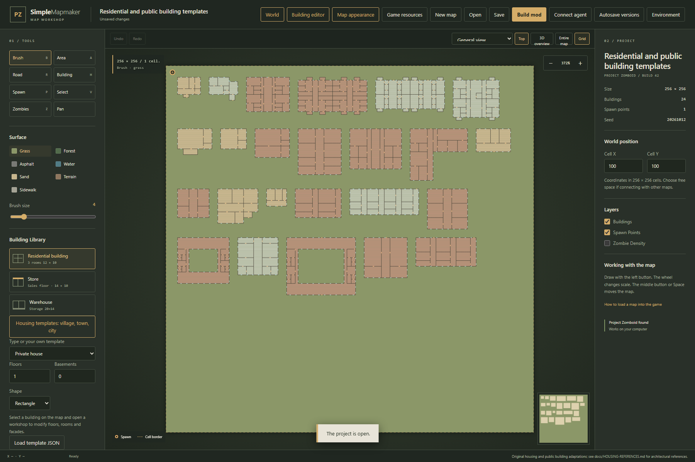

## Streamed world editor (development branch)

- **Work on one section:** save a world as a section workspace, browse its manifest and open only the section being edited. Switching saves committed edits first; stale revisions retain the local copy and offer an explicit reload/discard action.
- **See neighbouring geometry:** section outlines distinguish loaded and unloaded terrain. Crossing buildings, decorations, fences and infrastructure remain visible and reserved; shared geometry is read-only in an isolated section.
- **Share decorations across seams:** move a section decoration group into the world's **Shared decorations** layer. It is stored once in world tiles, and every section draws the part inside it.
- **Control editing layers:** hide or lock terrain, roads, paths, buildings, objects, models, spawns and authoring zones. Annotation order is adjustable; physical sprites keep their depth order.
- **Draw and review:** finish geometry drafts before applying them. Author polygon game/vehicle zones, reversible zombie-density regions and reviewed whole-room mappings. The merged core supports native fence lines and geographic rotation; unsupported adapter operations stay downloadable drafts. Buildings accept footprints from 2×2 tiles; under 6 tiles on a side a building is one room (a shed, kiosk or booth).
- **Export a saved revision:** section and world export jobs read immutable section data in sequence. Compatibility whole-world JSON loading retains its separate size limit.
- **Name and install the mod:** every export accepts a mod id, map folder and title, can place `media/maps` under `common/`, and can install straight into `Zomboid/mods` without replacing folders it did not create.
- **Build without the browser:** `simplepzmap build scene.json` imports a real place into a world, honours building tags (`pz:kind`, `pz:style`, `roof:colour`, `pz:wall`, `pz:trim`, attached buildings), runs the seam check and exports; `validate --game` checks every tile name against the installed game, `tiles` builds `.pack`/`.tiles` tile mods from PNG frames and `probe` loads the export with the game's own classes. [Command line guide](docs/CLI.md).

[Step-by-step section, layer and polygon guide](docs/STREAMED-WORLD-EDITOR.md) · [Zone semantics and API](docs/ZONE-AUTHORING.md) · [Core/editor integration contract](docs/SPZM-SCENE-CONTRACT.md)


## Accurate real-place transfer (development branch)

- **Source evidence:** retain original geographic geometry, stable source identities, addresses, entrance/access tags, observed facilities and barriers across OSM, tiled requests, regional PBF and GeoJSON point/polygon imports.
- **Editable sites:** group fully contained buildings, props, models and paths; adapt polygon vertices, review moves/copies, pin sites and apply changes with grouped undo/redo. Source boundaries stay separate from authored edits.
- **Transfer checks:** inspect missing buildings, source/grid drift, inferred floors, entrance outcomes and coarse scale. Optional live refresh invalidates stale results. Observed-service completeness remains unknown; displayed distances are explicitly straight-line.

[Installation and step-by-step real-place workflow](docs/REAL-PLACE-TRANSFER.md)


## Generation studio (development branch)

- **Context-aware districts:** era, land use, density, road setbacks, floors and courtyards; road-facing buildings with connected entrance paths.
- **Selective completion and regeneration:** fill empty OSM areas, preserve source/manual content, pin buildings or protect rectangles, compare two reproducible variants and apply one undoable change.
- **Visible evidence and quality:** distinguish source geometry from generated assumptions; inspect room/stair access, facade relationships, roads, courtyards, spawn routes and game zones with explicit coverage limits. Shared world geometry participates in section previews and checks.

[Step-by-step generation studio guide](docs/GENERATION-STUDIO.md)


## What's new in 0.11.2

- **Automatic game discovery:** startup reads Steam's registered libraries and installation manifests, including libraries on other drives. Stale saved paths fall back to detected installations.
- **Explicit manual connection:** open **Game resources**, paste a game folder and choose **Load folder** or press Enter. **Find installed game** lets you select a detected installation. Quoted paths and a pasted game executable path are accepted.
- **Resources on any drive:** game installations, Workshop folders and local mods can use different drives or accessible network shares. Resources are read only; caches/settings stay in the editor workspace. A failed folder choice retains the working catalog.

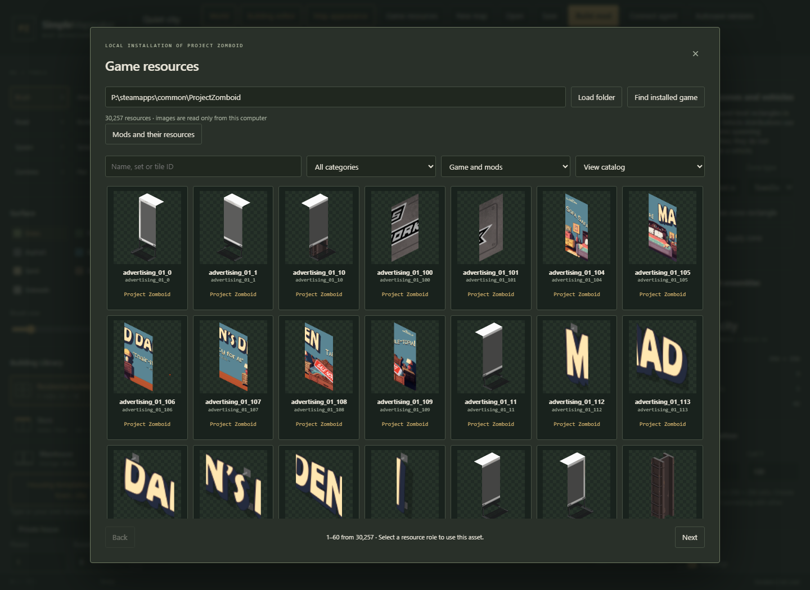

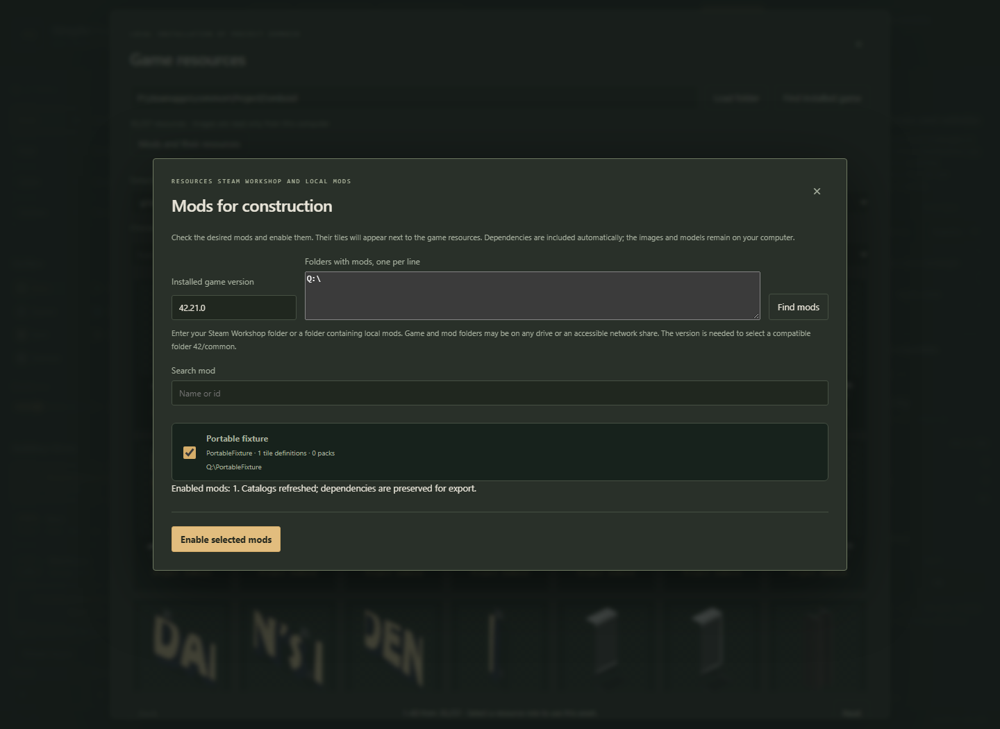

## What's new in 0.11.1

- **Shared world infrastructure:** author one road, river, railway or elevated bridge across adjacent sections. Decks, stairs, guard rails and underlays are generated together and clipped for native export. [Illustrated instructions](docs/WORLD-INFRASTRUCTURE.md).
- **Counted apartment buildings:** choose entrances, floors, apartments per entrance, layout and facade. Every generated apartment has actual rooms; entrance modules remain reusable. [Building and street generation](docs/PARAMETRIC-ENSEMBLES.md).
- **Street ensembles:** preview a coordinated building, access paths, parking, gated fences, greenery, benches and lighting as one bounded proposal. Applying it is one undoable change.
- **Pedestrian diagnostics:** **Check access** locates unreachable rooms, blocked approaches, broken stairs and unguarded upper edges, with floor-aware overlays and optional routes. [Access guide](docs/ACCESS-DIAGNOSTICS.md).
- **Checked agent proposals:** 55 MCP tools include isolated design/check/repair tasks, authentic native lighting evidence, bounded repairs, separate commits and visible before/after review. [Agent workflow](docs/MCP.md#checked-design-tasks-0110).
- **Background native exports:** keep editing while an immutable snapshot exports. Inspect progress, cancel, download completed ZIPs and reuse unchanged section data. [Export queue guide](docs/EXPORT-JOBS.md).


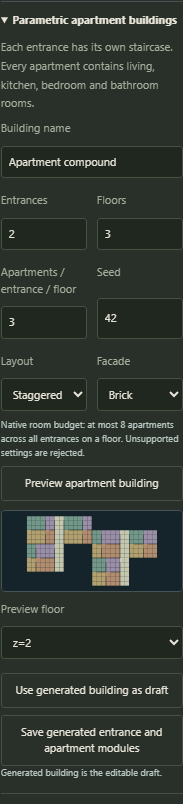

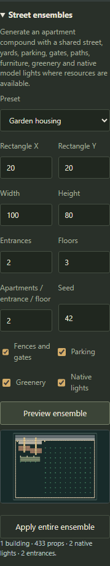


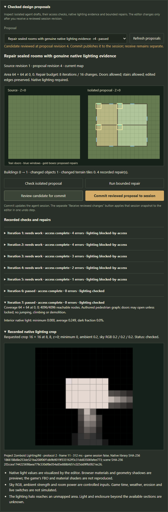

Try the synthetic [two-section WorldAuthoring source](examples/WorldAuthoring/world-authoring.pzworld.json) and its [native Build 42 archive](examples/WorldAuthoring/WorldAuthoring-B42.zip). It includes counted apartment houses, reusable modules, a shared river bridge and a clear road underpass. [Example instructions](examples/WorldAuthoring/README.md) explain its fixed coordinates and regeneration.

These checks run inside the editor. Access analysis describes authored pedestrian geometry under explicit door and crop assumptions; native lighting uses the installed game library. No character playthrough is started. Measured DEM remains a reference/export layer; continuous vehicle ramps and the full game renderer remain outside these tools.

## What's new in 0.10.0

- **Materials and geometry shadows:** textured game/mod meshes receive the native lighting field and cast editor shadows. Adjust roughness, metalness and sun direction inside the editor.
- **Compound buildings:** reuse entrances, stair towers, sections and annexes; capture your own modules, check placement and assemble them as undoable changes.
- **Elevated infrastructure:** native decks, stair access, rails, supports, underpasses and six atomic junction presets preserve underlying terrain.
- **Agent tools:** 47 MCP tools now include authentic read-only lighting calculations and isolated gameplay-zone proposals with revision protection and visual review.
- **Section workspaces:** open/save sections independently, reuse unchanged recovery data and export selected sections or the complete world through streamed archives.

Read the illustrated [step-by-step expansion guide](docs/EDITOR-EXPANSION.md) for controls, limits and examples. Native light values come from the game library; browser materials and mesh shadows remain editor previews. Infrastructure uses pedestrian stairs rather than continuous vehicle ramps.

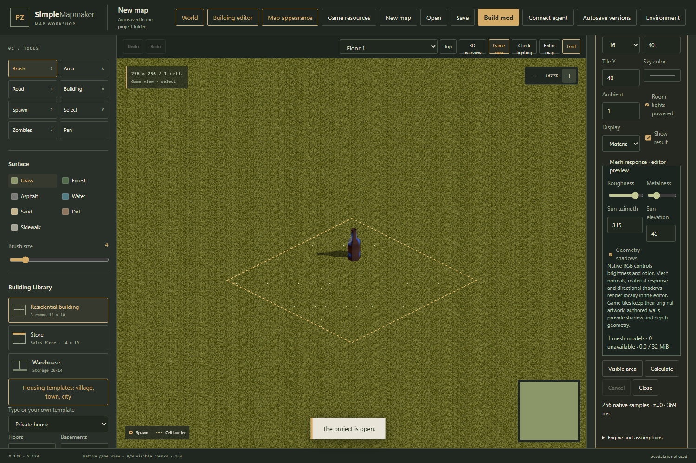

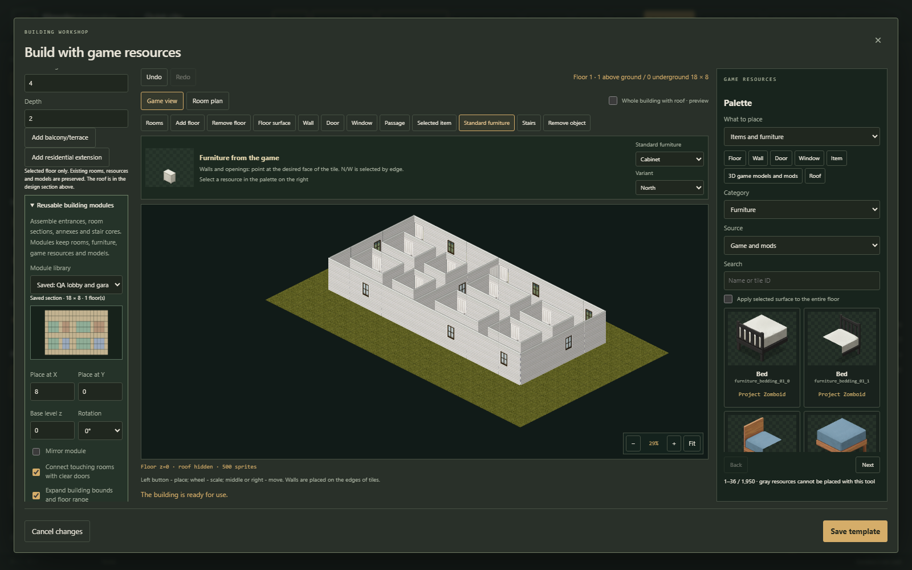

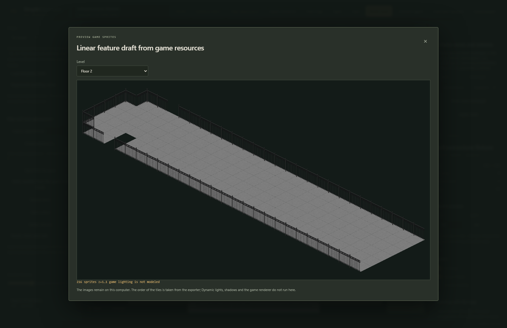

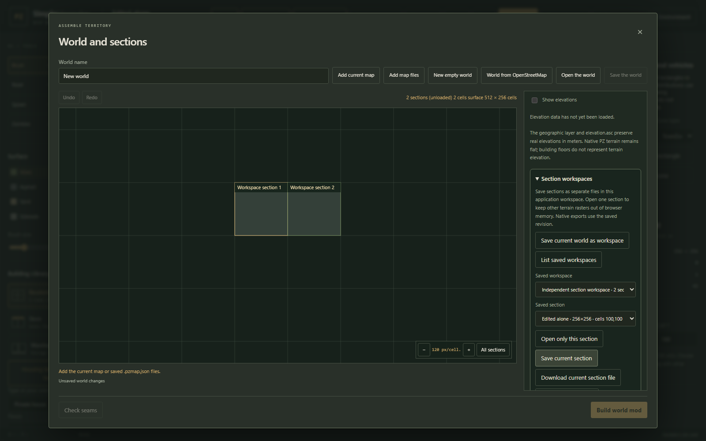

## Full Build 42 vertical range

Use all **64 signed levels, Z=−32…31**: 32 basement levels and 32 above-ground floors, including the ground floor at Z=0. The workshop and main Game view can add connected levels, preserve stairs and models, and preview the first and last signed floors. Native map/world export and lighting checks use the same range; older projects remain readable. The bounds match the [official Build 42 constants](https://projectzomboid.com/modding/constant-values.html#zombie.iso.IsoChunkMap.BOTTOM_LEVEL) and the installed game reader.

**Floor 32 is Z=31, not Z=32.** At this top level, choose **No automatic roof**. Adding the last floor selects this automatically. Pitched roofs also reserve their actual slope height; when adding a level would put a slope above Z=31, the editor selects a flat roof instead. Invalid manual roof choices are rejected without changing the draft.


Try the editable [full vertical range example](examples/FullVerticalRange/full-z.pzmap.json), or download its [native Build 42 map](examples/FullVerticalRange/FullVerticalRange-B42.zip). It contains one connected building with 32 above-ground floors and 32 basements, and an explicit open roof at Z=31.

Projects using extended levels or no automatic roof save as map format **10**, building template **7**, and world format **4**. Read the [direct editing guide](docs/DIRECT-EDITING.md) for level controls and signed-floor picking.

## What's new in 0.9.0

The [0.9.0 implementation commit](https://github.com/DinLemon/SimplePZMapmaker/commit/70718e4d3ec46b5e4631def90606f49ef906c12a) adds the following tools. For first-time setup, follow the [Windows installation instructions](#install-the-ready-to-run-windows-application) below.

### Edit buildings directly in Game view

Paint floors, rooms, building outlines, walls, doors and windows against actual game sprites. Place furniture and registered models from the game or active mods without leaving the main map. Add upper floors, basements and connected stairs; edit shared buildings across world-section boundaries. Each accepted stroke or object change is one undo operation. See the [direct editing guide](docs/DIRECT-EDITING.md).


### Preserve imported outlines and edit geographic paths

OpenStreetMap building footprints now preserve concave outlines and courtyard holes at game-tile resolution, with original source geometry retained in the project. Edit roads, rivers, sidewalks, bridges and railway paths through control points, widths and previews. Moving or removing a path restores its previous terrain while protecting later manual edits and complete object footprints. Curved roads and rivers support Catmull–Rom interpolation; railway artwork uses original cardinal track sprites, and bridge decks remain at ground level. See [path editing instructions](docs/DIRECT-EDITING.md#edit-roads-rivers-and-railway-paths).


### Author gameplay zones and interactive objects

Draw biome and vehicle-spawn rectangles directly on the map, select registered vehicle distributions and set their direction. Give models connected collision footprints, native doors with locks and keys, light sources, or container loot distributions. Authored zones, object properties and resource dependencies are included in native map and stitched-world exports. See the [gameplay authoring guide](docs/GAMEPLAY-AUTHORING.md).

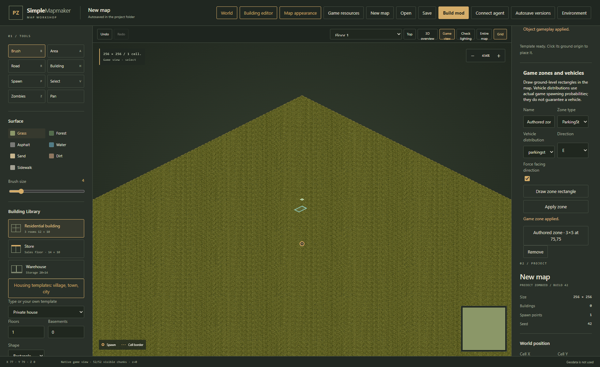

### Check native lighting inside the editor

Choose **Check lighting** to calculate a selected area with the installed game's `LightingJNI` library. Inspect returned cell colors on signed floors, including basements and nearby stitched sections. Control sky color, ambient strength, room power and authored light sources; inspect engine and scene fingerprints, cancel calculations and discard stale results after edits. The calculation opens no game session. The browser visualizes the native light field; it does not reproduce game FBO/material shaders, model-mesh shadows or live weather and switches. See the [native lighting guide](docs/NATIVE-LIGHTING.md).

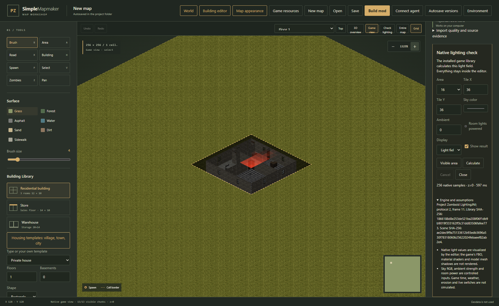

Validation for this implementation: **190 C# checks, 129 JavaScript checks and 18 installed native-lighting scenarios passed**, together with browser authoring/export/undo workflows and the [GitHub Actions build](https://github.com/DinLemon/SimplePZMapmaker/actions/runs/38558398809). See the [verification record](docs/STATUS.md) for scope and limitations.

## Install the ready-to-run Windows application

### 1. Check the requirements

- Windows 64-bit and a current browser such as Edge, Chrome or Firefox.
- A writable application folder. Temporary files, caches, recovery snapshots and logs stay beside the application, inside `work/`.
- **Project Zomboid Build 42** for real game-resource previews and resource-aware export. Choose your installation in the resource catalog; a typical folder is `<Steam library>\steamapps\common\ProjectZomboid`.
- Internet access for downloading the application, searching/importing online geography and downloading elevation. Local projects and saved geography open offline.

**Release users do not need Visual Studio, a .NET SDK, Node.js, TileZed or WorldEd.** The package is self-contained. Game files and Workshop resources are read from your installation and are not included. Build 41 is not supported.

### 2. Download the application ZIP

1. Open [GitHub Releases](https://github.com/DinLemon/SimplePZMapmaker/releases).
2. Select **v0.11.2**, or a newer published release. The project publishes prereleases, so use the release list rather than assuming GitHub's `/latest` page shows the newest build.
3. Expand **Assets** and download **`SimplePZMapmaker-0.11.2-win-x64.zip`**. Example map ZIPs contain game mods, not the editor. GitHub's automatic **Source code** archives are development sources, not the ready-to-run application.
4. Optionally download the release checksum file and compare the archive's SHA-256 before extracting it. Run this command from the folder containing the downloaded archive:

```powershell
Get-FileHash -Algorithm SHA256 -LiteralPath './SimplePZMapmaker-0.11.2-win-x64.zip'
```

### 3. Extract the entire archive

1. Create or choose a folder for the application.
2. Extract **all** files from the application ZIP into that folder. Do not launch from inside the ZIP viewer or copy only the executable.
3. Confirm that it contains `Start.cmd`, `scripts/`, `artifacts/app/`, `examples/`, `docs/`, and `LICENSE`.
4. Keep `artifacts/app/SimplePZMapmaker.Web.exe`, its bundled runtime DLLs and its `licenses/` directory together.

The launcher creates `work/` as needed. You can move the entire application folder while the server is stopped. Keep explicit saved projects separately when replacing an installation.

### 4. Start the editor

1. Double-click **`Start.cmd`**.
2. It starts `SimplePZMapmaker.Web.exe` in the background and opens **[http://127.0.0.1:48765](http://127.0.0.1:48765)**.
3. Wait for the map and tool panels. If the browser does not open, visit that address manually.
4. Keep the server running while editing. Closing the browser tab does not stop it. To stop it, end the `SimplePZMapmaker.Web.exe` process belonging to this application folder in Task Manager.

The server listens only on your computer's loopback interface. Another workspace or stale version on the same port is rejected. Startup logs are `work/logs/server.log` and `work/logs/server-errors.log`.

### 5. Connect the game resources

1. Open **Game resources**.
2. Startup automatically tries the saved selection, `PZMAP_GAME_PATH` and installed Steam libraries. Choose **Find installed game** to repeat discovery. If several installations are found, choose one from **Detected installations** and click **Load folder**.
3. For a copied or unregistered installation, paste the absolute folder containing `media/texturepacks` into **Installed game folder**. Click **Load folder** or press Enter. Paths may be on any drive or an accessible network share; surrounding quotes are accepted. Pasting the full path to `ProjectZomboid64.exe` or `ProjectZomboid32.exe` also selects its parent folder.
4. Search for a floor, wall or piece of furniture. A successful load shows real thumbnails from the game's `.pack` files.
5. Open **Building editor**, choose a building or new template, and use the game view to place resources visually.

The tested installation supplied 30,256 resources; this varies with the game version and mods. Catalog reads do not modify the game. Extracted atlas caches stay in `work/assets/` and are excluded from releases and exported mods.

No installation path is built into the application. Catalog selections are saved locally under `work/`. For development or test runs, you can set `PZMAP_GAME_PATH` and `PZMAP_WORKSHOP_ROOT` in your shell, or create `work/local-settings.json` with `gamePath` and `workshopRoot` fields containing your own paths. This file is ignored by Git and excluded from release packages; do not copy it into public documentation.

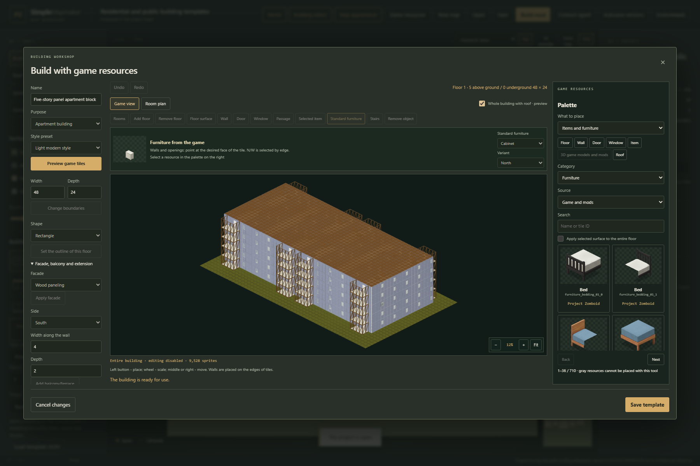

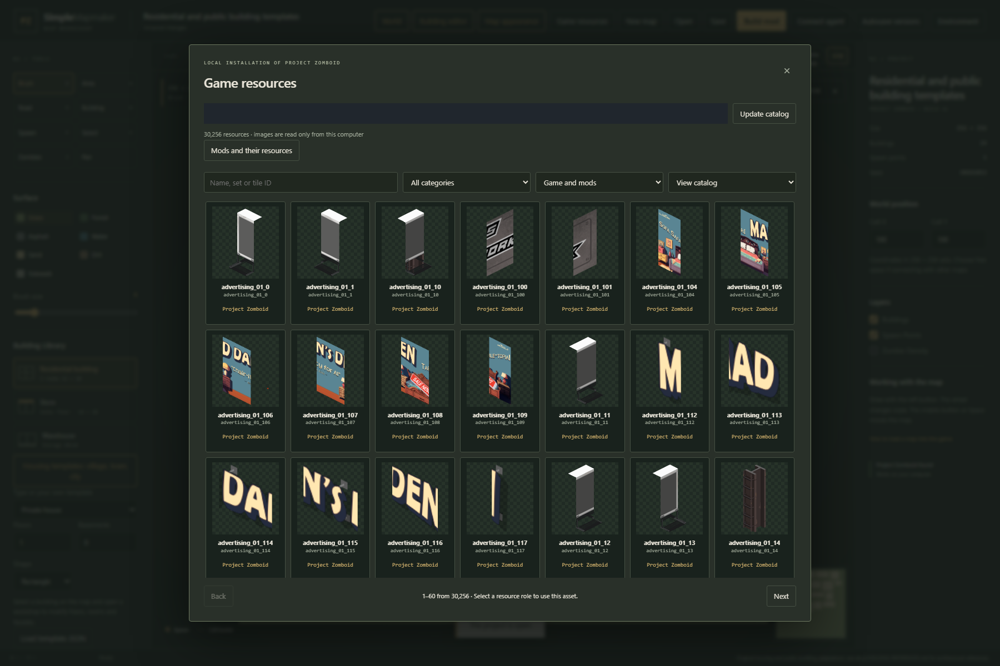

### 6. Enable optional Workshop resources

1. In **Game resources**, open the mod-resource controls.
2. Set the Workshop root to `<Steam library>\steamapps\workshop\content\108600` or the corresponding installation folder. Existing Workshop/local mod folders are suggested automatically. Additional absolute roots are entered one per line and may be on any drive or an accessible network share.
3. Enter the installed game version and discover mods. The verified installation reports 42.21, represented by `42.21.0` in the compatibility field.
4. Select and activate the desired mods. Dependencies load first. A missing/incompatible dependency produces an actionable diagnostic and retains the working catalog.
5. Filter resources by game, all active mods or a particular mod. Static models have a textured 3D viewer.

Players must install required mods separately. Export writes their IDs into `require` without redistributing artwork, textures or geometry. Details: [Mod resources](docs/MOD-RESOURCES.md), [Static models](docs/STATIC-MODELS.md).

### 7. Open an included example

Use **Open** for an editable map, or the world workspace's open control for `.pzworld.json`:

- `examples/Pilna/pilna.pzmap.json`: imported 2048×2048-tile settlement, 1,577 buildings. There is no dedicated Pilna button.
- `examples/Smolensk/`: editable 1.5 km section of central Smolensk, source geography, recipe and native mod.
- `examples/HousingTemplates/housing-templates.pzmap.json`: all 24 plans; individual `*.pzbuilding.json` files import into the template library.
- `examples/Basements/`: 16 above-ground levels and 16 basements.
- `examples/Assets/`: selected floors, walls, compound decorations, surfaces and vegetation.
- `examples/Worlds/World-DEM.pzworld.json`: two sections, shared house with cellar, authored roads/river and measured elevation near Smolensk. Its layout is a demonstration, not an OSM reconstruction.

Most example mods use native world origin **100,100**. Enable them **one at a time**, or move their coordinates and export again before combining them.

## Create a map and choose appearance

1. Create blank land, a small town or a forest-and-river map. One section is 256–2048 tiles; the seed makes generation repeatable.
2. Choose terrain/brush width at the left. **B** paints, **A** draws a rectangle, **R** draws a road at the selected width.
3. **H** places a building with a type, shape, 1–32 above-ground levels and 0–32 basements. Floor 1 is Z=0; Floor 32 is Z=31 and uses **No automatic roof**, because an additional roof at Z=32 is outside the game range. Buildings must stay on land without intersecting occupied structures. Native cell boundaries (each cell is 256×256 tiles) are supported.
4. **V** selects objects for moving, removal or editing. **P** places an outdoor spawn on land; at least one valid spawn must remain in the exported map/world. **Z** paints density 0–255 at 8×8 chunk resolution.
5. **Ctrl+Z / Ctrl+Shift+Z** undo/redo. Wheel zooms; middle/right dragging or Space pans. Save a `.pzmap.json` before a large replacement/import.

The 3D overview is schematic. The local game-sprite preview shows a 48×48-tile area using the native-export composer without running the game renderer.

To style terrain, open **Map appearance**, choose the whole map or a rectangular area, select a preset, preview it, then apply. Preview leaves the project unchanged; applying is one undoable edit. Presets alter surface families and vegetation while retaining roads, water, geometry and spawns. Optional automatic-building styling affects fully contained generated designs, preserving manual buildings and explicit resource choices. Up to 128 appearance regions are supported; later overlapping presets take priority. A whole-map preset clears regional presets while retaining manual resources.

## Edit buildings and environment visually

Open **Building editor** from the toolbar, select a building with **V**, or create a template before placement. In game view, choose a resource picture and paint directly into the building. Multi-cell furniture is placed and checked as one object. Walls, doors and windows attach to the nearest tile edge.

- Edit independent floor shapes, L/T forms, courtyards and extensions by adding footprint or removing floor. Maximum overall footprint: 64×64 tiles.
- Define rooms and purposes, then edit walls, doors, windows and passages. Balconies export as outdoor platforms with railings.
- Place north/west stairs and furniture. Stairs occupy five tiles including landings and require floor above; beds occupy two tiles. Automatic stairs connect levels.
- Copy floors upward and basements downward to **−16**. The first above-ground floor is game `z=0`. Basements are generated only when requested.
- Choose flat, gabled, shed or hipped roofs and compatible tile families. Facade tools alter exterior walls; balcony/annex tools add connected volumes while preserving the rest.
- Place game/mod models with pickup, scenery, obstacle, destructible or container behavior. Blocking profiles occupy one game tile regardless of visible scale; they are not structural walls or arbitrary collision meshes.
- Save to the project template library or exchange standalone JSON with attribution. Applying transfers a draft as one map edit; cancelling retains the original. Building-editor undo is separate.

Before applying/exporting, each room needs a route through doors/stairs to an exterior ground-level entrance. Independent entrances may use their own stair cores; no artificial apartment-to-apartment passage is required. Incomplete drafts remain editable.

The gallery includes **24** original izbas, cottages, farmsteads, bathhouses, duplexes, rows, schools, clinics, shops, barns, workshops, apartment blocks, courtyard houses and townhouses. They adapt real building types to the game grid, without reproducing exact construction drawings or working lifts. See [Housing references](docs/HOUSING-REFERENCES.md).

**Environment editor** displays a local area with actual sprites/models. Paint ground and paths, choose regional appearance, place compound objects, select one/several objects, move or remove them. Sprite rotation uses registered north/west variants; models have arbitrary rotation/scale. Apply records one undoable map edit. Required mod IDs/resource owners are stored; changing the owner stops export instead of silently substituting it.

## Import a real place from OpenStreetMap

1. Open real-place import, search for a town/address and select a result.
2. Choose the full settlement/district when small enough, or define a smaller area.
3. Preview bounds, choose size/source and import. Save first: geography replaces the current terrain.
4. Review imported/adapted/skipped features, scale and source date. On repeat imports of the same layout, preserve manual edits when desired.

Roads/polygons retain geographic proportions; widths use metres. Footprints become cell outlines with generated interiors. `building:levels`, `building:levels:underground`, `height` and `roof:shape` are read, distinguishing explicit data, height estimates and assumptions. Unsuitable geometry is reported.

For Smolensk, the regional source downloads an oblast PBF from [OSM France](https://download.openstreetmap.fr/extracts/russia/central_federal_district/smolensk_oblast-latest.osm.pbf), then extracts selected bounds locally without Overpass. The verified first download was about 44 MB; `work/geodata-cache/region-smolensk-oblast.pbf` is reused for seven days. The sample covers 1.5 km of the centre, not the whole city. The provider's `latest` snapshot can change.

Automatic OSM selection retries temporary failures through backup servers. A 504 is an external timeout; availability cannot be guaranteed. Failed/cancelled imports keep the current project. Saved GeoJSON/Overpass JSON imports work offline: WGS 84 `[longitude, latitude]`, supported lines/polygons/multipolygons, limits of 16 MB, 250,000 points and 30,000 features, plus polygon complexity limits.

The interface and authored examples are English; original imported OSM place names and source tags remain unchanged so the geographic source stays reproducible. OSM attribution is retained; its geography has separate ODbL obligations. Google Maps is not an exportable-geometry source. The editable railway layer uses original cardinal track sprites; diagonal and curved railway artwork is rejected explicitly.

## Native view, clipboard, palettes and import quality

Choose **Game view** above the main map to edit floors, rooms, outlines, walls, doors, windows, stairs and registered objects directly against game resources. Choose a signed floor and use **Edit in Game view**; every completed stroke is one undo operation. Read the illustrated [direct editing guide](docs/DIRECT-EDITING.md). The building editor adds floor/object clipboard, alignment, supported native rotations/mirrors, visual diagnostics and portable resource palettes. Neighborhood proposals add road-facing parcels, yards, fence gaps, parking and deterministic room-layout variation. The project inspector exposes source-versus-inference evidence and skipped outlines. Follow the illustrated [editor tools guide](docs/EDITOR-TOOLS.md).

## Stitch sections and use elevation

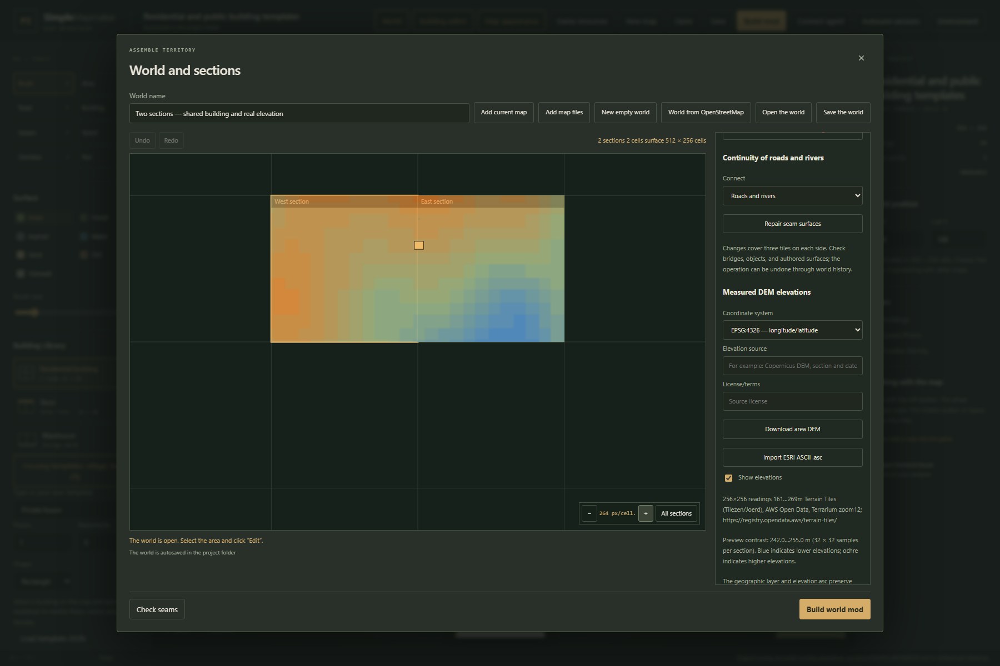

1. Open **World** (the World sections dialog) and add the current map or multiple `.pzmap.json` files.
2. Position sections in native cell coordinates (each cell contains 256×256 tiles); overlapping sections are rejected. Select a section to edit it; edits return to the world when switching sections.
3. Promote a building to the shared layer or place a template across section boundaries. Shared buildings use absolute game-tile coordinates and are clipped for section export; models are emitted once.
4. Review road/water seams. The connection operation joins compatible roads/rivers within three tiles on each side while protecting objects and manual terrain. Roads facing water need a manual bridge.
5. Import ESRI ASCII DEM (EPSG:4326/3857), or download from [Terrain Tiles](https://registry.opendata.aws/terrain-tiles/). Use the elevation overlay to plan.
6. Save `.pzworld.json` or export one combined mod with shared spawns, zones and atlas.

**One editor section is limited to 2048×2048 tiles; this does not limit the entire PZ world.** Worlds allow 128 sections/8,192 native cells, with files up to 128 MB and ZIPs up to 256 MB. OSM world imports share one projection, split requests, and allow at most 768 cells/15 minutes. Preserved reimports require identical bounds, scale and layout.

DEM retains heights, NODATA, coordinates, source, license and import time; import time is not measurement time. Limits: one million samples, two-minute network budget, seven-day cache. **Native PZ ground stays flat.** `elevation.asc` is exported as a data sidecar, not floors or invented slopes. Details: [World and environment](docs/WORLD-AND-ENVIRONMENT.md).

## Connect an MCP agent

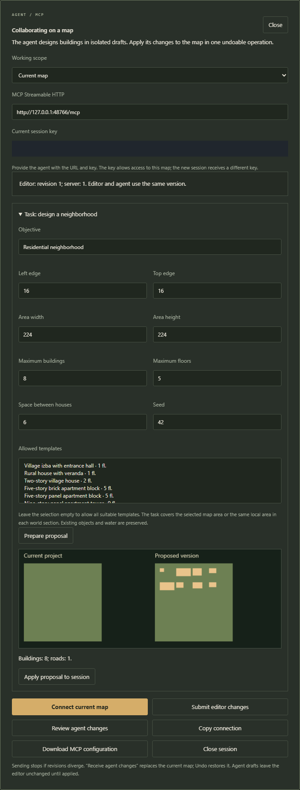

1. Keep the application running and open **Connect agent**.
2. Choose the map or the whole world; add world sections first.
3. Create a session and pass the endpoint **`http://127.0.0.1:48765/mcp`**, key, scope and revision to an MCP-capable agent.
4. Download the sample Streamable HTTP configuration and add it to your client. The key is supplied as tool argument `sessionToken`, not stored in the sample configuration.
5. Ask the agent to inspect resources, draft buildings or propose neighbourhood/world plans with explicit constraints.
6. Review the before/after view and object list, then explicitly receive reviewed changes. Undo restores the preceding editor project.

The 47 tools support searches, complete templates, rooms/edges/objects, validation, previews, shared buildings, constrained proposals and native export. Stale revisions are rejected; closing the session revokes access. Local session/proposal files stay in `work/`; there is no arbitrary shell/filesystem execution. The editor does not modify your Codex settings. Full instructions: [MCP](docs/MCP.md).

## Save, recover and install an exported map

Save downloads an editable project. Recovery files stay in `work/recovery/`; the browser stores a linking identifier. Clearing browser data removes the link, not the files. Keep explicit files for sharing and long-term storage. Recovery controls expose current and three previous versions; damaged current snapshots fall back to a valid backup.

History is bounded/sparse, so large actions can remove older entries. A world replacement needing over 512 MB of history is refused before mutation: save the current world, then open the result into an empty world. Supported formats: maps **1–8**, templates **1–5**, worlds **1–2**. New layers raise their version; old editors reject newer formats to protect data. Model behaviors use map 7/template 5, shared buildings/DEM world 2.

1. Build the mod and download its ZIP.
2. Extract the complete `SimplePZMap_<identifier>` folder into the configured game-user-data `Zomboid/mods` folder. This is not the Steam installation's `media` directory. Choose your own user-data location; the editor never installs files automatically.
3. Install dependencies listed in `INSTALL.txt` and enable them together with the map mod.
4. Create a **new game** using the exported map. Existing saves are not migrated.
5. Enable overlapping example mods separately, or relocate and re-export them.

Exports include Build 42 `mod.info`, `common/`, native `.lotheader/.lotpack/chunkdata_*.bin`, room/building definitions, spawn points, zones, biome maps (`maps/biomemap_X_Y.png`, which Build 42 needs for foraging zones; squares with buildings, roads, fences, decorations or spawns use the featureless `dirt` biome so WorldGen never replaces authored vegetation there with its own jumbo trees), a 256×256 `thumb.png`, world map XML, editable project, attribution and installation instructions. Like the vanilla maps, `spawnpoints.lua` starts players inside houses (the living room, kitchen or bedroom of every building with a bedroom, up to 256), gives all 25 Build 42 professions a key, and adds workplaces such as a police office or a restaurant kitchen for matching professions. Authored spawns are used only when the map has no house. Name/seed determine the mod ID; changing either creates a different ID. Origin defaults to native cell 100,100.

## Build from source

Release users can skip this section.

1. Download **.NET 10 SDK** from the [official .NET download page](https://dotnet.microsoft.com/en-us/download/dotnet/10.0), **Node.js 24** from [nodejs.org](https://nodejs.org/en/download), and **Git for Windows** from [git-scm.com](https://git-scm.com/install/windows). Choose Windows x64 packages; an ASP.NET/.NET runtime alone cannot compile sources.
2. To keep tool installations off the system drive, use the SDK's **Binaries → x64 ZIP**, Node's Windows **ZIP** distribution, and portable Git. Extract them under your chosen tools directory and add their executable directories to the current PowerShell session's `PATH`. Existing installations can be used instead. Confirm `dotnet --version` starts with `10.`, `node --version` starts with `v24.`, and `git --version` returns a Git version before continuing.
3. Clone into your chosen workspace. If the folder is an existing checkout, update it instead of cloning over it.
4. Run from the repository root and load `WorkspaceEnv.ps1`; it directs task temporary files, .NET/NuGet/npm caches and Chromium data into `work/`.

```powershell
git clone --branch develop https://github.com/DinLemon/SimplePZMapmaker.git './SimplePZMapmaker'
Set-Location -LiteralPath './SimplePZMapmaker'
. ./scripts/WorkspaceEnv.ps1
dotnet --version
node --version
dotnet run --project src/SimplePZMapmaker.Web
```

Open `http://127.0.0.1:48765` once started. Stop the foreground development server with **Ctrl+C** before another server uses its port. In another PowerShell window from the same root:

```powershell
. ./scripts/WorkspaceEnv.ps1
./scripts/verify.ps1
./scripts/publish.ps1
./scripts/package.ps1
```

Verification runs C#/JavaScript checks and a Release build. Publishing writes the self-contained application to `artifacts/app/`; packaging writes the ZIP under `artifacts/`. Do not overwrite a running executable. Initial MCP/runtime package restore needs internet, and downloads stay inside the workspace.

Optional full browser and installed-game probes:

```powershell
. ./scripts/WorkspaceEnv.ps1
npm install --prefix work/qa --no-audit --no-fund --ignore-scripts playwright
node work/qa/node_modules/playwright/cli.js install chromium --only-shell
# Keep the application running for browser/MCP checks.
node scripts/verify-browser.mjs
node scripts/verify-building-workshop.mjs
node scripts/verify-world-workshop.mjs
node scripts/verify-environment-workshop.mjs
dotnet run --project tools/McpSmoke
# Independent archive reader; no game needed.
node scripts/verify-native-map.mjs
# Installed-game/JRE probes do not launch a play session.
./scripts/verify-game-runtime.ps1
./scripts/verify-game-runtime.ps1 -MapArchive examples/Basements/Basements-B42.zip -Basements
./scripts/verify-static-model-runtime.ps1
```

QA downloads/screenshots/logs stay in `work/qa-results/` or `work/logs/`. Development uses `develop`.

## Run it in GitHub Actions

**Build and verify** builds the editor and launches the published application on runner loopback without a game or shared runtime. An HTTP check generates, validates and exports a native mod, which an independent reader verifies. A Chromium check saves a project, changes its name, reopens the saved file and verifies that its original state is restored. The workflow uploads **SimplePZMapmaker-win-x64** and **Application-startup-check** artifacts.

1. Open **Actions** in the GitHub repository and select **Build and verify**.
2. Choose **Run workflow**, select `develop` or the branch to verify, then start.
3. Inspect build/startup/browser steps in the run.
4. Download the completed application artifact for local use. Extract GitHub's outer artifact archive, then extract the contained `SimplePZMapmaker-0.11.2-win-x64.zip` into the application folder and follow the installation steps above. The diagnostic artifact contains startup evidence and screenshots. GitHub may require sign-in for artifacts.

CI runs on pushes to `develop`, pull requests and manual dispatch. The Windows runner uses its mapped checkout as the workspace and keeps task caches there. Its no-game fallback check does not replace local installed-game probes.

**Actions runs are temporary, not permanent hosting.** The app process ends with the job; runner `127.0.0.1` cannot serve your local browser. Download and run the application locally for editing. See [build.yml](.github/workflows/build.yml).

## Troubleshooting

- **Launcher asks for an SDK:** use the `win-x64` asset and extract it completely; a source archive or missing executable triggers the development build path. The complete release needs no SDK.
- **Port 48765 occupied / stale server:** stop the corresponding `SimplePZMapmaker.Web.exe` and restart the desired workspace. Do not stop unrelated .NET processes.
- **Blank browser / startup timeout:** inspect `work/logs/server.log` and `server-errors.log`, check extraction, and open the loopback address manually.
- **Missing game images:** verify game path and refresh the catalog. Basic editing/saving work without the game; resource-aware operations need the owning catalog.
- **Mod activation failed:** follow the missing dependency chain, add its root or install it or select the right version. The previous catalog remains active.
- **OSM 504 / timeout:** retry later, use the Smolensk regional source when applicable, or import saved geography. Failed/cancelled imports retain the project.
- **Building cannot apply/export:** inspect disconnected rooms, entrances, stairs/landings, furniture/model overlap, water and section coverage. Drafts remain editable.
- **Agent conflict:** read the current revision and generate a new review; only the reviewed revision can be received.
- **Example map conflict:** examples can share origin 100,100. Enable one or relocate/re-export them.
- **No hills from DEM:** elevation is an overlay/data sidecar; native terrain stays flat.

## Validation and limits

Independent native readers and selected installed-game loaders check archives, upstairs/basement rooms and stairs. Static-model probes exercise actual game collision approaches and container capacity. Browser checks cover editing, imports, world assembly, recovery and agent review. These do **not** establish a complete character playthrough, exact visuals for every mod model/roof, loot balance or multiplayer/save-reload correctness. Dated evidence: [STATUS.md](docs/STATUS.md). Historical paths/download cleanup and updating an existing clone: [Publication privacy](docs/PUBLICATION-PRIVACY.md).

Unofficial and unaffiliated with The Indie Stone. Code/original plans: **GPL-2.0-or-later**; OSM geography: separate **ODbL** obligations. Game/mod resources and reference images retain their owners' rights. Read [PROVENANCE.md](docs/PROVENANCE.md), [RUNTIME.md](docs/RUNTIME.md) and bundled licenses.

## Author gameplay in the editor

Use **Game zones and vehicles** to draw ground-level biome or vehicle-distribution rectangles. Select a model in **Game view** for its collision footprint, native door, light and container properties. [Step-by-step gameplay authoring](docs/GAMEPLAY-AUTHORING.md) explains the controls, export behavior and power assumptions.

## Check lighting without leaving the editor

Use **Check lighting** in **Game view** to calculate a selected area with the installed game's native lighting library. The editor displays actual returned cell colors and engine/scene fingerprints, with controls for sky input, room power and authored model lights. No game session or character walk is started. Signed basements and neighboring stitched sections participate in the calculation. The browser visualizes the native light field; game FBO shaders, material rendering, model-mesh shadows, live weather and switches remain explicit limitations. Follow the [illustrated native lighting guide](docs/NATIVE-LIGHTING.md).
