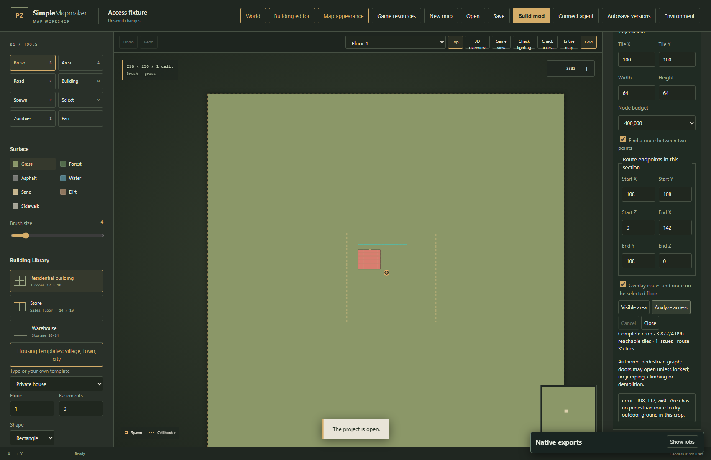

# Pedestrian access diagnostics

**Check access** beside **Check lighting** opens a read-only analysis panel. It checks authored geometry without starting a game session. It never moves furniture, unlocks a door, or edits the map.

## Check part of a map or world section

1. Open a map, or open a section from the world workshop.
2. Click **Check access**. **Visible area** centers the analysis crop on the current view.
3. Set **Tile X**, **Tile Y**, **Width** and **Height** in local section coordinates. A crop can cover up to **256 × 256** tiles. Keep the complete building and its outside approach inside the crop for reliable entrance results.
4. Choose a node budget from 100,000 to 500,000. Each supported tile on each floor consumes one node; many floors can exceed the budget even within a small crop.
5. Optionally enable **Find a route between two points**. Enter both endpoints inside the crop, using signed floor coordinates from **−32 through 31**.
6. Click **Analyze access**. The report states whether coverage is complete, how many tiles connect to outside ground, its issue count, and the route length when a route exists.
7. Click an issue row to select its floor and center the map on its coordinates. Red cells show errors, amber cells show warnings, and teal cells show the selected route. The dashed rectangle marks the checked crop. Overlays display on the selected floor; changing floors preserves the report.

The report identifies inaccessible areas, obstructed doors/passages, unsupported stair transitions, and unguarded upper-floor edges. It uses full furniture and model footprints, water, authored wall/window edges, native north/west stair landings, locked model doors, and projected shared world infrastructure. Ordinary closed doors may open during analysis; locked doors remain closed. Jumping, climbing, breaking furniture and demolishing walls are outside this pedestrian graph.

## Coverage and stale results

An area cut by the crop boundary does not produce an unreachable-room conclusion. A partial graph or exhausted node budget is explicitly marked **Partial analysis**. Enlarge or move the crop, or reduce its floor count, before treating access as fully checked. A missing route only concerns the selected crop and endpoints.

Editing the project, switching sections, or refreshing resources clears old results. Run the check again to obtain evidence for the current revision. Changing the crop or route inputs also invalidates the report. **Cancel** aborts the request; **Close** hides the panel.

## Building workshop

Under **Copy, transform and check**, click **Analyze pedestrian access** to check the current draft through the same backend analyzer. Coordinates are local to the building. Click an issue to select the affected signed floor. The draft remains editable even when the report describes a blocked entrance. Editing the draft invalidates its previous report.

## HTTP integration

- `POST /api/access/check`: `{ project, options, revision }`, or `{ world, memberId, options, revision }`. `options` contains `x`, `y`, `width`, `height`, `maximumNodes`, and optional `start`/`end` objects with `x`, `y`, `z`.
- Response: `{ revision, report }`, including `complete`, `coverage`, `nodes`, `reachable`, `issues`, `notes` and `path`.
- `POST /api/access/building`: a building draft; returns its report directly.

Consumers must retain the request revision and discard a response after their source changes. Diagnostics are evidence from the authored graph, not a character playtest.
