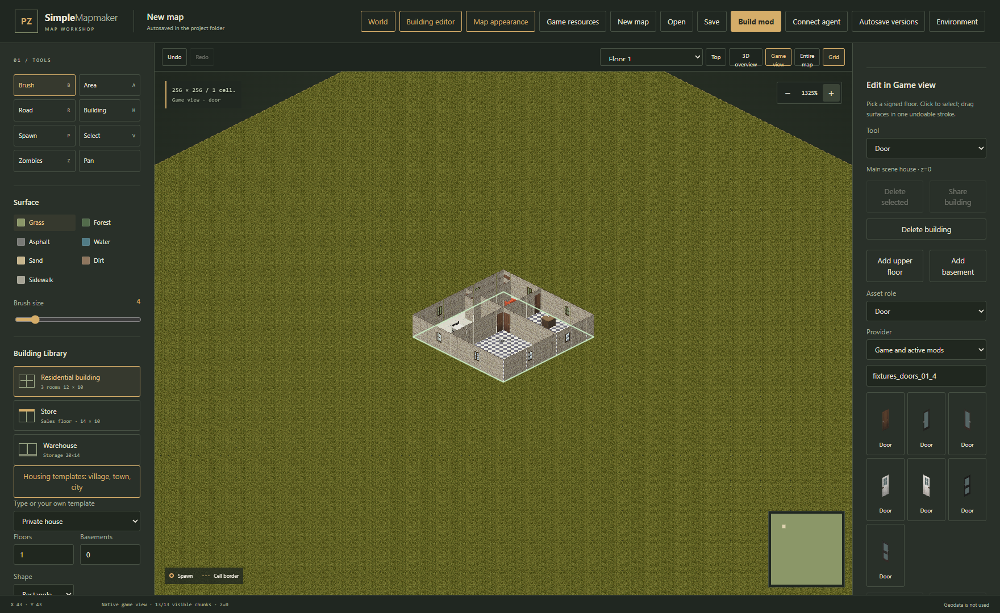
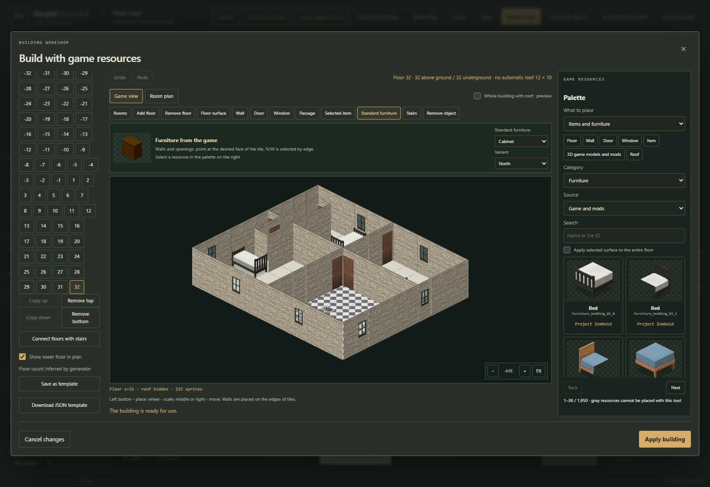
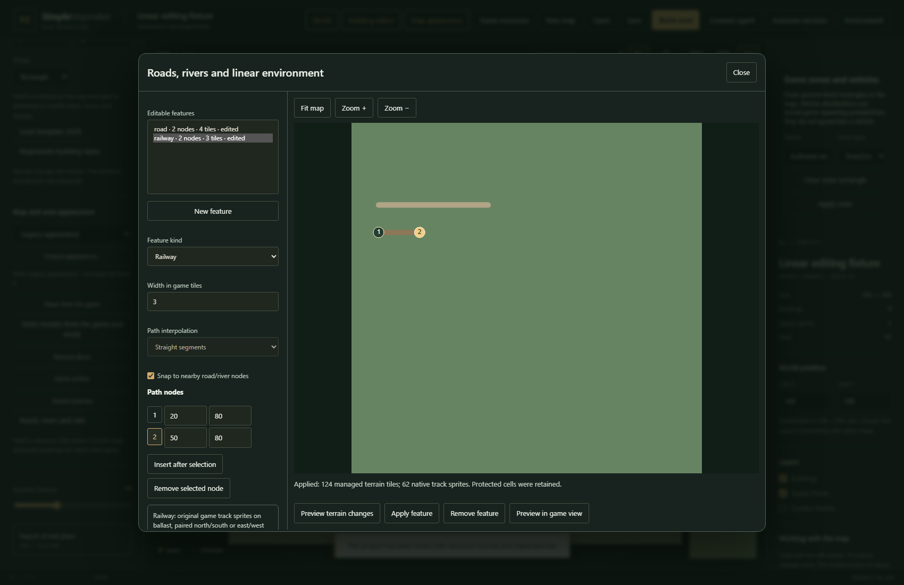

# Edit buildings directly in Game view

1. Open or generate a map, then choose **Game view** above the main canvas. Choose one signed floor; **All levels** is for inspection.
2. Use **Asset role**, **Provider** and the resource search in **Edit in Game view** to pick an installed game or active-mod resource. Floor, wall, opening and furniture brushes use game sprites. Models use registered geometry and textures from their provider.
3. Drag a floor, room or wall brush across the building. A stroke is a draft until release. The editor validates the whole change before applying it as one undo operation. Escape or a cancelled pointer gesture discards the draft.
4. Choose **Select** and click a floor, edge, complete object or model. The highlighted footprint shows which cells belong to the object. Model gameplay properties appear in the same inspector. Changing them validates before replacing the placement.
5. Use **Add floor** to expand the footprint, **Remove floor** to remove an empty cell, or **Add upper floor** / **Add basement** to add a connected level. Supported building levels run from **−32 through 31**: 32 basements and 32 above-ground floors. Floor 1 is Z=0. Adding Floor 32 (Z=31) selects **No automatic roof**; a generated roof would otherwise occupy invalid Z=32. Every level remains editable, with models and lighting checks using the same signed range. Stair placement and added levels must pass the building access checks.
6. Use **Move selected** to move a whole building, selected object or model. **Delete selected** acts on the selected part; **Delete building** removes the entire structure.

Pan with the middle mouse button, or hold Space while dragging. Zoom with the wheel or the buttons. The active signed floor determines picking; objects on a different floor are not silently edited. Choose an individual floor before painting.

The workshop keeps the ground floor mandatory and disables adding levels at either cap. Copying an upper floor preserves signed model coordinates and adds only the new staircase link. **No automatic roof** leaves the final level open; a flat or pitched automatic roof still needs its own space inside Z=−32…31. Templates with extended levels use format 7, maps use format 10, and stitched worlds use format 4; their older formats remain readable.

For a stitched world, open a section and choose **Edit section**. A shared building keeps its absolute world position. An edit to its visible part updates the shared building and remains one world undo operation, including when its footprint crosses a section boundary. **Share building** moves a local building to the shared layer.

Resource availability follows the current game/mod catalog. A changed catalog clears an old brush. Unsupported variants, blocked placements and stale validation responses leave the original project intact. Models retain explicit tile footprints; a visible mesh alone does not define structural collision.

## Edit roads, rivers and railway paths

1. Open **Roads, rivers and rails**. Select a saved imported feature, or choose **New feature**.
2. Choose road, river, sidewalk, bridge or railway. Click the plan to add nodes, or edit their coordinates in the node list. Choose a width and, for curved roads/rivers, **Catmull–Rom** interpolation.
3. Choose **Preview terrain changes** to inspect the staged result. Preview does not change the project. **Preview in game view** shows resolved native sprites for the staged path.
4. Choose **Apply feature** to validate and commit the whole path. Moving an existing path restores its previous underlay while preserving later manual changes. Undo and redo restore both the path and its affected terrain.
5. Choose a saved path and **Remove feature** to remove its generated terrain and decorations. Removing a bridge restores the river beneath its ground-level deck.

Railways use the installed game's native railway sprites and support straight cardinal segments. Diagonal or curved railway geometry is rejected; it is not replaced by a misleading approximation. Bridges are ground-level decks, without elevated underpasses. Source path coordinates and tags remain in the project for evidence; they are separate from generated interiors and manually edited terrain.

## Draw game zones

Open the game-zone controls, choose the zone type and **Draw zone rectangle**, then drag a snapped rectangle on the main canvas. Review its bounds and properties before applying. Zone editing participates in the same map/world validation and undo history. Vehicle distributions and container loot references must come from the installed game's catalog or an enabled mod; unknown references are rejected.
