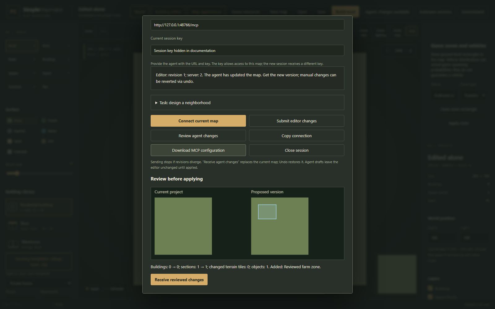

# Lighting, modules, infrastructure and section workspaces

These tools are available in 0.10.0. Install the ready-to-run Windows application as described in the [README](../README.md#install-the-ready-to-run-windows-application), then select your installed Build 42 resources. No additional renderer, model editor or MCP server process is required.

## Light on models and materials

1. Open a map, switch to **Game view**, and select one signed floor.
2. Choose **Check lighting**. Select an area of 8–64 tiles, sky color, ambient strength and room power, then choose **Calculate**.
3. In **Display**, select the materials/shadows view. Textured registered models use the returned native RGB field. Change roughness and metalness to inspect their material response.
4. Adjust sun azimuth and elevation, then enable **Geometry shadows**. Model meshes and authored wall geometry cast directional shadows onto the receiving surface. Change floors or authoring and calculate again; old results are discarded.
5. Expand **Engine and assumptions** to inspect the library, scene fingerprints and warnings. Cancel a running calculation from the panel.

The light field is calculated by the installed `LightingJNI` library without launching a game. Material response and directional mesh shadows are browser previews. They do not reproduce the game's FBO/material shaders, live weather or character visibility. Original tile artwork is retained; authored walls supply depth/shadow geometry. Mesh collision footprints do not automatically become opaque walls in the native light calculation.

The view retains at most 32 distinct assets, 96 model instances and 32 MiB of measured asset data, with 2048-pixel render buffers. Unavailable or capped assets retain their original preview thumbnails. Closing the view cancels pending loads and disposes GPU resources.

## Reusable building modules

1. Open **Building editor**, then expand **Reusable modules** in its inspector.
2. Choose an entrance, room section, stair tower or annex from the built-in modules or your saved library. **Use module as draft** starts a building from that design.
3. Set local X/Y, base level, rotation and mirror. **Check placement** validates the complete candidate. Enable bounds expansion and automatic connecting doors when needed.
4. Choose **Assemble module into draft**. Rooms, signed floors, objects, models and resource ownership are baked into the building. Undo removes that assembly as one change.
5. To make your own module, select a rectangle and consecutive signed levels, choose its name and role, then choose **Save selection as reusable module**. The selection must include complete furniture/model footprints and stair transitions.
6. Export a selected module as `.pzbuilding.json`, or save the current map to retain its module library. Import it using the template importer.

Modules are ordinary building-library templates; assembled buildings use the existing export pipeline. Unsupported directional sprites, reversed native stair ascent and mirrored model geometry reject rather than silently misorienting resources. Use catalog-verified facing variants or author that orientation as another module. The final building remains limited to 64×64 tiles and Z=-32..31.

## Bridges, underpasses and junctions

1. Choose **Roads, rivers and rails**. Select or create a path and set its **Deck level**.
2. A nonzero level creates native floors without repainting the underlying road, water or terrain. Enable pedestrian stair access, guard rails and optional spaced supports. Supports leave road/pavement tiles clear.
3. Preview the candidate at its selected floor. Switch preview floors to inspect the deck and the lower passage separately.
4. Choose a junction preset to create a crossing, T-junction, roundabout, overpass, underpass or stacked crossing as one atomic group. Preview before applying; Undo restores the previous map. Group removal retains independent later terrain edits.
5. Keep decks and their stair landings inside the section. A 512+ tile map supports structures crossing its native 256-tile cell seams. Separate world sections currently own separate path geometry.

Access uses native cardinal stair runs with floor openings. Underground paths retain the ground ceiling except stair shafts. These are discrete signed floors and pedestrian access; continuous inclined vehicle ramps are not provided. Main terrain and measured DEM stay at their original levels. Elevated/junction authoring uses map format 11 and world format 5.

## Open and save sections independently

1. Add maps in **World** and expand **Section workspaces**. Choose **Save current world as workspace**.
2. The workspace stores a small atomic index, shared world metadata and independent immutable section files. Unchanged files are reused across the current and three previous recovery revisions.
3. Choose **List saved workspaces**, select an index and a section, then **Open only this section**. Other section terrain is not downloaded to the browser. The previous complete world is saved to recovery before detaching it.
4. Edit the section normally. Reopen **World → Section workspaces**, then choose **Save current section**. Only the changed section and index are committed; a stale revision rejects the save. Layout and dimensions require **Load complete world** and a full workspace save.
5. **Download current section file** creates a portable `.pzmap.json`. **Export saved section** exports only that section's native cells, including clipped shared buildings, and retains a valid local project plus a small shared-world context file. **Export saved world** creates the combined native mod.
6. To see or edit authoritative shared buildings across sections, choose **Load complete world**. Section-only mode retains shared data in the workspace; shared-building intersections are validated when saving.
7. Native exports use the saved revision. Save editor changes before exporting. Keep a portable `.pzworld.json` backup; the internal section index is an application workspace index, not a standalone portable world file.

Whole-world recovery verifies content fingerprints and restores a previous complete revision when the latest index or a section is damaged. Independent section reads and saves do not deserialize unrelated terrain. Native export writes cell data directly into the final archive, without building/reopening a ZIP for every section, and serves the completed workspace file instead of retaining a complete archive byte array in HTTP memory. Temporary files are deleted when the response closes. Limits remain 128 sections, 8192 cells, 128 MiB of stored authoring and 256 MiB per native archive.

## Agent lighting and gameplay zones

Connect a map or world through **Connect agent**. The MCP server exposes 47 tools, including `lighting_status`, `lighting_map_check`, `lighting_world_check` and `lighting_draft_check`. The light calculation is read-only, bounded and revision-checked. A draft check does not commit its building.

Use `gameplay_catalog` for supported zone types and registered distributions; `gameplay_zones_read` reads existing zones. `gameplay_zones_plan` validates 1–64 explicit zone rectangles in an isolated map/world proposal. Existing IDs replace only their own zones; new IDs add. `gameplay_zones_plan_read` inspects the proposal and `gameplay_zones_plan_commit` commits against the base revision. World entries include their section `memberId` and use local section tile coordinates. Gameplay zones remain at Z=0.

Choose **Review agent changes** to inspect the colored zone rectangles and object list, then **Receive reviewed changes**. The editor receives them as one undoable operation. Unknown distributions, overlap, water/building intersections and stale revisions reject the batch.

See [MCP configuration and reference](MCP.md). Source/build, actual browser workflows, installed lighting and native-reader checks are recorded in [verification status](STATUS.md). No character playthrough, gameplay save or multiplayer test is claimed.
