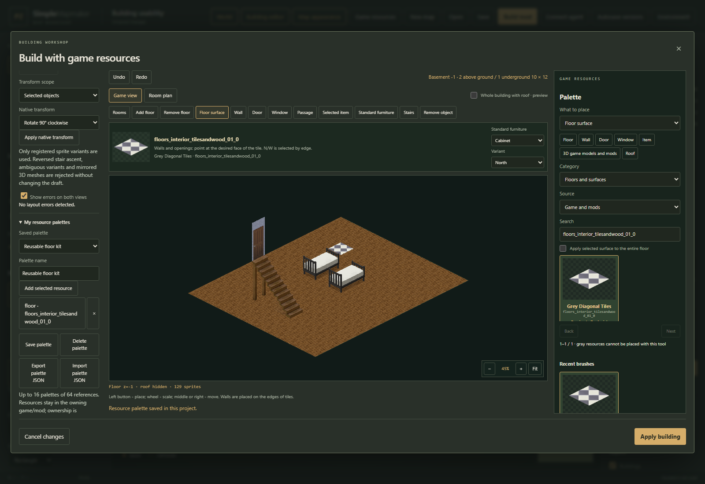

# Native view, building tools and neighborhood planning

## Inspect the main map with game resources

Choose **Game view** above the map, then choose a signed floor or **All levels**. The first visit uploads one validated snapshot; panning fetches visible native-cell chunks. The view uses exported tile identifiers and registered model geometry, textures, attachment transforms and physical scale. Select **Top** for terrain drawing. To paint buildings in the main canvas, follow the [direct Game-view editing guide](DIRECT-EDITING.md).

Use the wheel or the **+**/**−** controls to inspect resources. Game view permits 96 pixels per half-tile axis; other map views retain their previous zoom limit. At overview scales terrain is sampled and forest sprites are thinned. Authored walls, furniture, shared buildings and models retain their positions and size. The status bar reports sampling and missing resources. The resource preview does not simulate character behavior. **Check lighting** adds a light field calculated by the installed native library; follow the [native lighting guide](NATIVE-LIGHTING.md) for its controlled inputs and rendering limits.

Client limits are 96 chunks, 24 MB of chunk JSON and 96 MB of atlas images, with two concurrent chunk requests. The server keeps at most four snapshots within an estimated 192 MB budget, four composed cells per snapshot, and expires idle snapshots after five minutes. Expired views renew automatically with a bounded retry. Resource catalog changes invalidate the view.

## Copy, transform and diagnose a building

1. Open **Building editor**, load a template or edit a placed building, and select one signed floor.
2. Choose **Copy floor**, select a destination floor and choose **Paste floor**. Stair connections must still match the surrounding levels.
3. Choose **Select objects** and drag a rectangle around complete objects. Shift adds to the selection. Copy the selection, choose a destination cell and paste; alignment also acts on complete footprints.
4. Select a transform scope and operation, then choose **Apply native transform**. Rotation and mirroring resolve actual registered sprite variants and recheck resource ownership. Ambiguous variants, reverse stair ascent and mirrored model meshes are refused before the draft changes. Undo restores the entire previous draft.
5. Enable **Show errors on both views** to highlight inaccessible rooms, stair problems and object conflicts in the room plan and game-resource canvas. Fix the highlighted cells before applying the building.

**All levels** is a preview mode; clipboard and transform edits are disabled there.

## Save a portable palette

1. Pick a resource in the building palette and expand **My resource palettes**.
2. Give the palette a name and choose **Add selected resource** for each desired brush.
3. Choose **Save palette**. Saving the map retains up to 16 palettes with 64 resource references each, using map format 8.
4. Choose **Export palette JSON** to transfer a `.pzpalette.json` file. On another project choose **Import palette JSON**, then save the imported draft.

Palettes store references and provider metadata, not game/mod assets. An unused palette does not activate its mods. Selecting a palette resource checks the current catalog, owner and supported placement role again; missing or conflicting providers produce an error instead of substituting another mod's resource.

## Generate road-facing parcels

Open **Connect agent**, create a map or world session and prepare a neighborhood proposal. Choose **Follow existing streets**, **Regular blocks**, **Courtyard housing** or **Rural parcels**; set road width, variation, yards, parcel fences and parking. Select allowed templates to restrict architecture.

The proposal includes building entrances, access paths, yards, driveways, parking and fence gaps. Variation changes compatible room boundaries, doors, furnishings and appearance deterministically while protecting staircase cores and authored basement layouts. Zero variation retains the source plan. Water, existing objects and manually edited terrain remain protected.

Inspect the colored proposal and counts before **Apply proposal to session**, then review and receive the session into the editor. Applying checks resource owners and all changes atomically. Stale revisions or provider conflicts leave the project unchanged. Undo restores the previous map/world. Shared buildings remain on the world's shared layer.

## Review imported geography

Expand **Import quality and source evidence** in the project inspector. It distinguishes tagged floor counts, height estimates and assumptions from generated interiors and roofs. Skipped outlines retain bounded source identifiers and reasons, such as unsuitable geometry or collision with preserved buildings.

Select an imported building to inspect its evidence and correct its floors. A correction records the manual decision while preserving original source tags. Imported source outlines retain concave footprints and courtyard holes when they fit the editor grid. Original survey rings and source-grid resampling remain visible in the evidence. Unsuitable shapes are reported as skipped; generated interiors and roofs remain approximations. Use the [path editing guide](DIRECT-EDITING.md#edit-roads-rivers-and-railway-paths) to revise roads, rivers and native railway layers.

Native exports include both readable `worldmap.xml` and its Build 42 IGMB version 2 binary companion. The companion preserves the same cell polygons and properties and avoids the installed Build 42 XML point-count parser problem.
