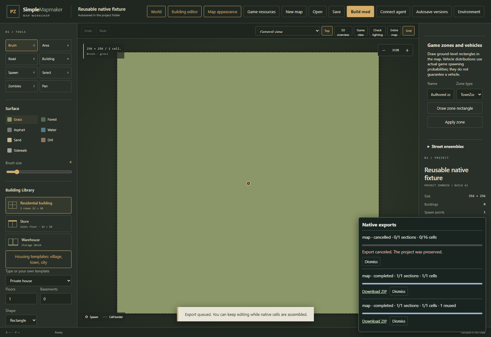

# Background native exports

Native map, world and saved-section exports run in a bounded background queue. You can continue editing while an immutable snapshot is assembled. The existing synchronous export endpoints remain available for integrations.

## Export and monitor

1. For a map, choose **Build mod → Download ZIP**. For a complete world, use the world workshop's export button. Saved section workspaces offer **Export saved section** and **Export saved world**.
2. The **Native exports** panel lists the queued snapshot. It reports completed sections and native cells as work proceeds. The panel's **Minimize / Show jobs** control keeps it out of the editing controls.
3. **Cancel export** cancels a queued or running job. Cancellation removes its incomplete archive; edits made before or during the export remain untouched.
4. A completed job downloads its ZIP through a file URL. **Download ZIP** in the panel can download it again. The archive includes the appropriate original project or world source and installation instructions.
5. Reloading the editor restores retained job status. Previously completed jobs do not download again automatically. A restarted application marks unfinished jobs **interrupted**; queue a fresh export to resume work from a new snapshot.

An export uses its accepted snapshot, not subsequent changes in the editor. Saved workspace exports use the saved world revision, including the saved shared buildings and infrastructure. Save an edited section first if that edit should be included.

## Limits and disk storage

- At most **2 running** jobs and **8 queued** jobs; a full queue returns a readable error.
- Each immutable source snapshot is limited to **128 MB**. Each final ZIP is bounded to **256 MB during writes**, including ZIP directory finalization. Large worlds should be exported as separate selected sections.
- A job has a **30-minute** execution deadline. Disk and permission failures produce a job error rather than a partial downloadable archive.
- Job metadata and archives live under `work/export-jobs`. Up to **24 terminal jobs / 1 GB of retained output** are kept. Older archives can expire; export the source again when needed.
- Validated native cell fragments live under `work/native-section-cache`, bounded to **128 sections / 512 MB**. Eviction affects performance only; it never edits a source project.

The server streams ZIPs to workspace files and streams those files to the browser. It does not buffer a complete native archive in application memory or package another complete section ZIP inside the final ZIP.

## What is reused

An unchanged section's native cells are reused without running the expensive tile composer again. The cache key hashes the projected section content, resource ownership metadata, the exporter build/format, and shared infrastructure geometry that is intentionally absent from ordinary project JSON. Terrain edits, buildings that cross a section boundary, shared bridge levels, furniture, spawns, zombie density and resource-provider changes therefore invalidate affected cells.

World-level metadata, source JSON, zones, atlas outlines and installation files are written afresh. A local section edit can preserve reuse for other unchanged sections. Corrupt fragments rebuild; canceled incomplete fragments never enter the reusable cache. Startup recovery only cleans files with the export subsystem's owned names inside its workspace directories.

## HTTP integration

- `POST /api/export/jobs` accepts a map project.
- `POST /api/world/export/jobs` accepts a complete world.
- `POST /api/world/export/jobs/sections/{memberId}` accepts a complete world and exports one selected section with shared context.
- Saved workspaces accept `POST /api/world/workspaces/{id}/export/jobs` and `POST /api/world/workspaces/{id}/sections/{memberId}/export/jobs` with `{}`.
- Each creation returns HTTP **202**, an immutable `snapshotHash` / `revision`, and a job `id`.
- `GET /api/export/jobs` lists retained jobs; `GET /api/export/jobs/{id}` returns status, progress, error and download URL.
- `POST /api/export/jobs/{id}/cancel` accepts `{}`. `GET /api/export/jobs/{id}/download` streams a completed ZIP.

The original `/api/export`, `/api/world/export`, saved workspace export URLs and revision-bound agent download URLs keep their synchronous ZIP behavior.
