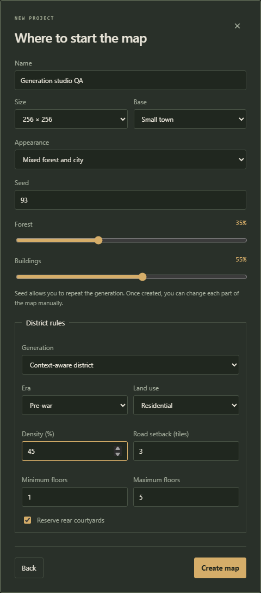
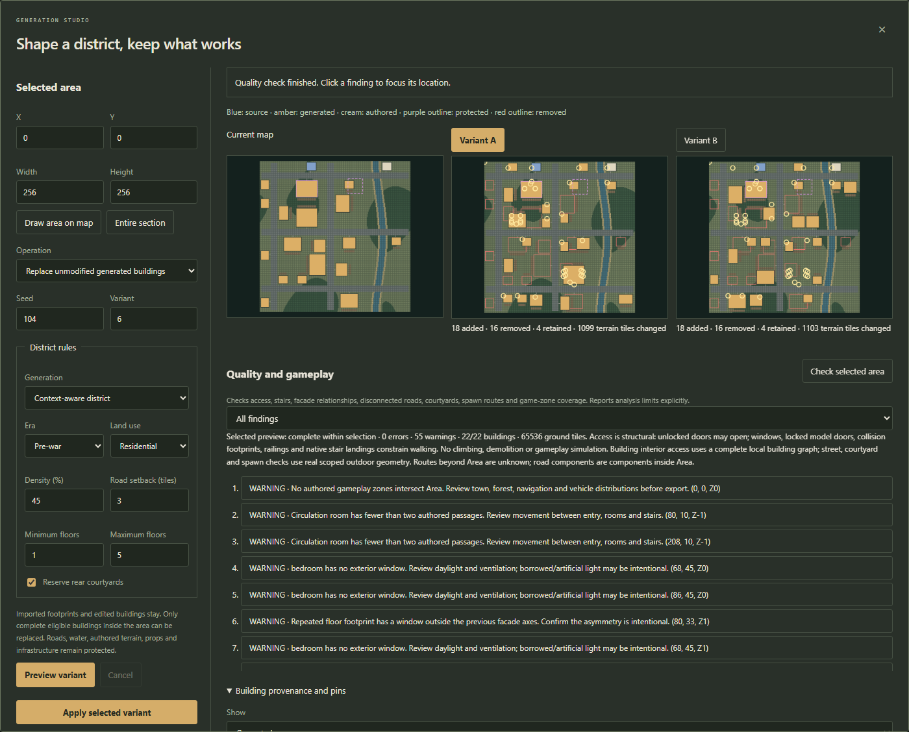

# Generation studio

Generation studio adds context-aware districts, selective geographic completion, protected areas, repeatable alternatives and structural quality checks to the existing map editor. It works on a standalone map or the section currently being edited in a world.

## Create a district

1. Start the application and choose **New map**.
2. Select **Small town** as the base. **Blank section** deliberately creates no street network; draw streets before asking the studio to fill it.
3. Expand/use **District rules**. Select **Context-aware district**, then choose an era and land use.
4. Set **Density (%)**, **Road setback (tiles)**, the minimum/maximum above-ground floors, and whether to reserve rear courtyards.
5. Choose a seed and create the map. Road-facing placements use the selected era/use and provide entrance paths. Context rules apply to the town generator; the wilderness and blank bases retain their purposes.
6. Choose **Legacy random town** if you want the previous generation behavior. Existing projects do not need migration.

Era controls the building vocabulary (pre-war, Soviet, modern or mixed). Land use chooses residential, industrial, rural or mixed development. Floors and setbacks are placement constraints, not a promise that every possible template fits. Density controls attempts; water, existing content and available road frontage can reduce the final count.

## Fill missing geographic data

1. Import OpenStreetMap or GeoJSON through the existing geographic tools.
2. Open **Generation studio** in the top toolbar.
3. Choose **Fill available space / complete OSM**.
4. Enter the area's **X**, **Y**, **Width** and **Height**, or choose **Draw area on map**, drag a rectangle in the map and release. **Entire section** restores the full current map rectangle.
5. Choose district rules, a seed and a variant, then click **Preview variant**.
6. Inspect the preview before applying. The original geographic buildings, outlines and source tags remain intact. New buildings fill suitable empty sites; the generator does not infer missing streets or claim to recover real interiors.

The evidence view distinguishes source footprints, adapted source bounds, manually edited source geometry, generated buildings and authored buildings. Source floor tags, height estimates and inferred floors remain distinct. A real exterior outline does not establish a surveyed floor plan.

## Keep buildings and areas

- Select a building in the map before opening the studio and choose **Pin selected building**, or use **Pin** beside a row under **Building provenance and pins**.
- To protect a whole rectangle, select it and click **Protect selected area**. Its buildings and terrain stay untouched by generation. **Unprotect** removes that protection.
- Filter the building evidence list by provenance when reviewing a large import. The list shows at most 200 matching rows at once; filter further to inspect other origins.
- Pins, area rectangles and accepted settings are saved inside the project. They participate in undo/redo, recovery and world-section storage.

Pins protect content from generation. The normal editing tools remain available for deliberate manual changes.

## Compare and selectively regenerate

1. Choose **Replace unmodified generated buildings**. Imported, manually authored, manually edited and pinned buildings are retained automatically.
2. Set the target rectangle. Buildings crossing its boundary are retained as a whole; the studio never cuts off part of a building.
3. Choose **Preview variant**. The map at left remains the current project; Variant A is an isolated proposal.
4. Preview again to obtain Variant B. The variant counter advances automatically; the seed and rules are unchanged. The studio retains two alternatives at a time.
5. Click **Variant A** or **Variant B** to select one. Compare counts of added/removed/retained buildings and terrain changes. Blue denotes source geometry, amber generated buildings, cream authored buildings, purple protected content, and red outlines removed buildings.
6. Click **Apply selected variant**. Application is one undoable operation. **Undo** restores the previous project; **Redo** reapplies the accepted result.

Changing settings invalidates previews. A failed or cancelled preview clears old applicable proposals. Applying also checks the original map fingerprint; a changed map must be previewed again. Server proposals expire after 15 minutes and are bounded to 12 entries / 64 MiB, so reopen/re-preview if a proposal expires.

The same original project, seed, variant and rules reproduce the same generation result. Once a result has been accepted, that result is a different original for subsequent generation. Existing access paving is retained; regenerated buildings may therefore choose other free frontage.

## Check architecture and gameplay

1. Choose **Check selected area**. With a variant selected, the studio audits that candidate; without a candidate it audits the current map.
2. Read the coverage line as well as the error/warning counts. **INCOMPLETE coverage** means only the reported area/building budget was inspected.
3. Filter findings by errors, architecture, access, roads or gameplay.
4. Click a finding to close the studio and focus its map coordinates and Z level. Inspect/edit the affected building or environment with the existing tools, then run a new check.

Checks include pedestrian approaches, unreachable rooms, stair and basement links, enclosed courtyards, disconnected roads/decks, spawn routes, zone coverage, exterior window/room relationships and repeated facade axes. Daylight, room ventilation, circulation and asymmetric facades can produce advisories rather than structural failures. They do not prohibit intentional designs.

The audit is structural: unlocked doors may open; collisions, locked model doors, fences, railings, stair steps and floor openings constrain routes. It does not simulate zombies, loot rolls, climbing, demolition or an in-game character walkthrough.

Default limits are 128 buildings, 512 tiles per side / 262,144 ground tiles, 2 million aggregate building-access nodes and 2,048 visible issues. Additional geometry work has explicit caps too. Every exhausted cap marks coverage incomplete; choose a smaller rectangle and run more checks. Road components and outdoor routes are local to the inspected area; a connection outside it may be intentional.

Without an installed game catalog, base-game structural generation and preview/apply remain available. Sprite materials and native physical properties are not verified in that mode: previews state this limitation and quality coverage is marked incomplete. Connect the game to verify resources. Projects requiring mod resources or static model definitions still need their catalogs.

## Work in a world

Open the world, select a section and choose **Edit section**, then use the studio. Preview, apply and quality checks include projected shared buildings, shared roads/rivers and elevated infrastructure. Those projections remain transient; they are not copied into the raw section. A shared-world geometry change invalidates an older proposal even if the local section did not change.

## Troubleshooting

- **No buildings added:** inspect the warning. Draw/connect a street, enlarge the rectangle, reduce density/setback/floors, or remove a protection deliberately. Blank/wilderness sections do not gain a street network through the fill operation.
- **A building was retained during regeneration:** it may be source/authored/edited/pinned, intersect a protected area, cross the selected boundary, or touch manually authored terrain, props or infrastructure.
- **The map/world changed:** preview again against the current snapshot. This prevents applying an obsolete alternative over newer work.
- **Resource error:** enable the required game/mod resources. A failed preview keeps the current project untouched.
- **Incomplete quality coverage:** split the inspection into smaller areas. A partial check is never a whole-world pass.

## Verification

The feature has automated domain checks for deterministic districts and access, protections, source provenance, server-owned snapshots, world projections and diagnostics; browser verification exercises rules, two variants, failure/cancellation, pins/areas, quality navigation and apply/undo/redo/save/reload. The screenshots above come from that actual browser workflow with synthetic QA content.
