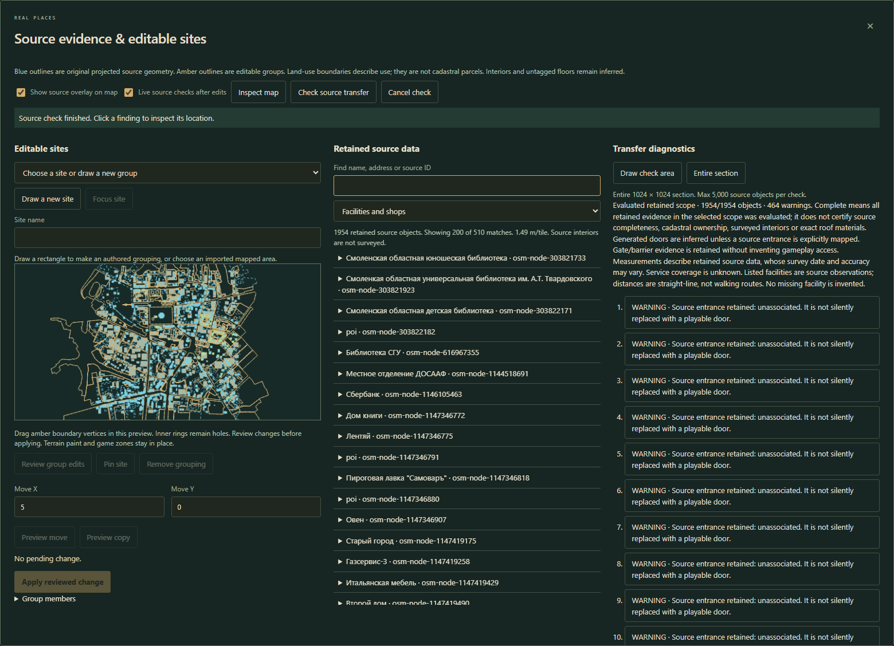
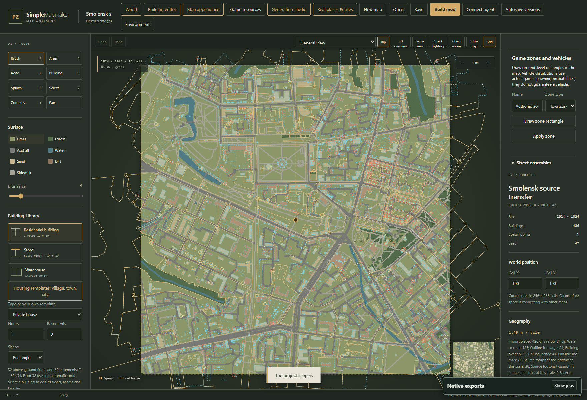
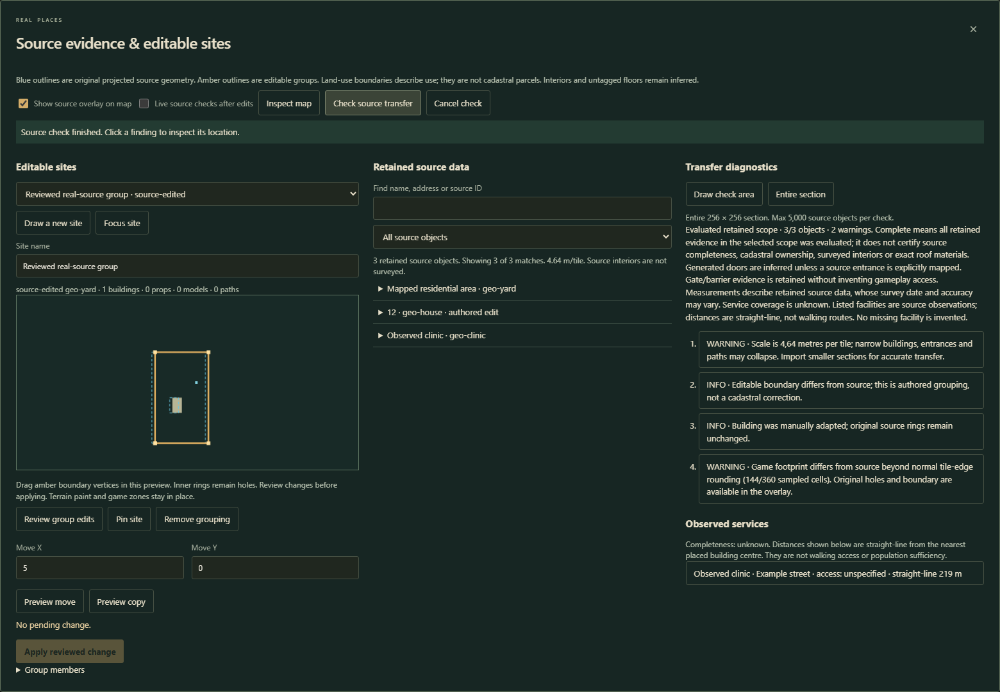

# Real-place transfer and editable sites

The development build adds **Real places & sites** to the top toolbar. Its purpose is to retain real geographic observations, adapt them deliberately to the game grid, and expose missing or changed data. It does not claim to recover surveyed apartment interiors or cadastral ownership.

## Install or update

1. For a published release, follow the [Windows installation instructions](../README.md#install-the-ready-to-run-windows-application). This feature currently belongs to the development branch; an older release ZIP will not contain it.
2. For the development version, download a successful `develop` GitHub Actions application artifact, or clone the repository and run `scripts/publish.ps1` followed by `scripts/package.ps1 -ArchiveName SimplePZMapmaker-source-sites-win-x64.zip` from PowerShell in the project folder.
3. Extract the complete application archive into its own folder, then run `Start.cmd`. The Windows package includes the .NET Runtime. Keep the `artifacts/app` folder and its contents together.
4. Connect the game through **Game resources**. Game and mod files can reside on any accessible drive; the editor keeps its own caches in its workspace.
5. Keep a copy of an existing map before a new geographic import. To inspect the new source layer on a legacy map, reimport the original bounds and size with **Preserve edits** selected. Old projects open without migration, but they cannot supply point observations that their original import discarded.

## Import actual geographic data

1. Open the geographic import dialog, search for a place, and choose a bounded area.
2. Use small neighbouring sections when transferring a city. Check **m/tile**: compressing a wide city into one small section collapses entrances and narrow footprints. The transfer checker warns above 2 m/tile; this threshold is a diagnostic, not a claim that coarser data can be restored exactly.
3. Choose OpenStreetMap, the supported Smolensk regional extract, or a GeoJSON file. GeoJSON `Point`, `LineString`, `Polygon`, `MultiLineString` and `MultiPolygon` are supported. Preserve original feature IDs when your provider has them.
4. Import. Original geographic rings/coordinates, bounded relevant tags, names, addresses, entrance/access roles and source IDs are stored separately from game geometry. Buildings that cannot fit are retained as evidence even when no game building is placed.
5. Open **Real places & sites**. Search by name, address or source ID and filter buildings, entrances, mapped areas, facilities, address points or barriers. Expand a row to read actual source tags, then choose **Locate source**.

Overpass requests include tagged nodes as well as ways/relations. Tiled responses clip and deduplicate node IDs. The regional PBF reader retains tagged regular/dense nodes and relevant barrier/healthcare ways. Old Overpass cache keys are invalidated for the expanded query. Source completeness remains unknown regardless of how many objects were returned.

## Read the overlays

- Dashed blue geometry: retained original source projected onto this map, before author edits.
- Amber geometry: editable grouping boundary. Purple marks a pinned site.
- Small green marks: source entrances. Other point observations are blue.
- Finding rings: locations reported by the latest source-transfer check. They disappear as soon as the map changes.

Choose **Inspect map** to close the workbench while retaining the overlay. Turn **Show source overlay on map** off to inspect the ordinary editor view. Overlay rendering is bounded to the first 5,000 retained records; use source filtering and checks on smaller areas for larger data sets.

## Make and edit a site

1. Choose an imported mapped area from **Editable sites**, or click **Draw a new site** and drag a rectangle in the map.
2. Name the group. Imported land-use, school/campus, hospital and similar polygons retain source provenance; an authored rectangle is explicitly authored. A land-use polygon is not a property survey.
3. Expand **Group members** and select complete buildings, environment props, registered models and local paths. New rectangular groups initially select their fully contained buildings. The editor validates full object footprints and path widths before accepting changes. Objects crossing the boundary remain separate.
4. Drag amber vertices in the workbench preview to adapt a boundary. Original source geometry remains blue. Existing interior rings remain holes. At most 500 member candidates are displayed; smaller groups are easier to edit.
5. Choose **Review group edits**, inspect the preview and result message, then **Apply reviewed change**. The change creates one undo operation.
6. To translate or duplicate the group, enter integer **Move X** and **Move Y**, choose **Preview move** or **Preview copy**, inspect the result, and apply it. A copy receives new object identities and does not claim to be another occurrence of the original real building.
7. Choose **Pin site**, review and apply. Pinned boundaries reserve their actual polygon, excluding holes, against settlement generation. Unlock before translating, editing or removing the group. Pins do not replace ordinary object-edit controls.
8. **Remove grouping** removes only the group. Its buildings and environment objects stay. Deleting an individual member detaches its group reference in the same history operation.

Translations affect grouped objects and the editable boundary. Ground paint, game zones and independent service/source observations stay in place. Group operations stay within the current section; shared world buildings and paths crossing sections are read-only evidence in this tool. Use the existing world tools to author shared structures. Objects with overlapping group membership must be ungrouped from the other site before moving a group.

Source associations check both the original polygon (including sub-tile crossings) and the quantized occupied footprint. Crossing outlines are excluded with an association note. Import supports at most 512 editable sites and 4,096 vertices per site; larger source areas remain evidence. Bounded association work can leave members unknown, which the checker reports explicitly.

## Check transfer accuracy

1. Choose **Draw check area**, or keep **Entire section**.
2. Click **Check source transfer**. The checker compares retained source footprints to actual placed buildings and identifies missing buildings, footprint drift, authored adaptations, inferred floors, unresolved entrances, coarse scale and incomplete associations.
3. Click a finding to focus its location in the map. Use **Generation studio → Check selected area** for structural room/stair/road access checks; source agreement alone does not establish playability.
4. Enable **Live source checks after edits** for a debounced refresh. Every map change invalidates previous results and aborts the older request. A late response cannot overwrite findings for a newer map or world section. **Cancel check** stops the current work.
5. Read the coverage message. **Evaluated retained scope** means the retained observations in that scope were processed. **INCOMPLETE analysis** means a feature/work/site limit or missing legacy evidence prevented a complete analysis. Neither wording certifies that the upstream geographic database contains every real object.

**Observed services** lists facilities and shops actually tagged by the source, with their address/access values. Distances are straight-line from the nearest placed building centre, in metres when scale is known. They are not walking routes, catchment areas or claims that the settlement has sufficient services. Missing school/clinic/shop tags do not prove that such services are absent in real life.

Ground-level unrestricted source entrances can map to unambiguous supported exterior edges when no adjacent generated furniture blocks them. Sealed entrances, restricted access, upper/indoor levels, exits/emergency roles, uncertain associations and unsupported edges retain explicit outcomes. Other generated door positions remain inferred. Barrier evidence is retained without inventing native gate physics.

## Persistence and verification

Sites, source records, names/addresses and pins survive JSON save/load, undo/redo, recovery and world-section projection. **Preserve edits** retains generation controls, game zones, authored groups, and edited/pinned buildings; memberships are remapped by source identity when necessary. Explicit source IDs remain stable across source order and label changes. For anonymous GeoJSON objects, deterministic geometry/tag fingerprints distinguish identical-shaped objects at different coordinates; provider IDs are preferable for tracking subsequent survey corrections.

The real-data browser verification uses a cached Smolensk OSM extract, not newly invented city geometry. Tests cover source identities, point-only data, tiled/PBF nodes, entrance outcomes, original polygon containment, grouped multi-object movement/copy, reversible path terrain, failed-operation atomicity, history, pins, live refresh and saved-source round trips. Native export is checked independently against the binary format and installed game classes. No interactive game session is part of this verification.

To rerun browser verification, install Playwright under the workspace with `npm install --prefix work/qa playwright`, start the editor, set `PZMAP_TEST_URL` to its local address, then run `node scripts/verify-source-sites.mjs`. The first run requests the supported Smolensk extract if no QA source map exists; allow its bounded regional download to finish. It saves disposable projects/screenshots under `work/source-sites-browser` and uses an isolated browser context. Run the native decoder with `node scripts/verify-native-map.mjs <exported-map.zip>` and the installed-class probe with `scripts/verify-game-runtime.ps1 -MapArchive <exported-map.zip>` after exporting the QA map.

Source semantics: [OSM entrance](https://wiki.openstreetmap.org/wiki/Key:entrance), [OSM land use](https://wiki.openstreetmap.org/wiki/Key:landuse), [OSM amenities](https://wiki.openstreetmap.org/wiki/Key:amenity), [OSM data attribution/licence](https://www.openstreetmap.org/copyright). Provider rights and survey limitations still apply to imported data.
