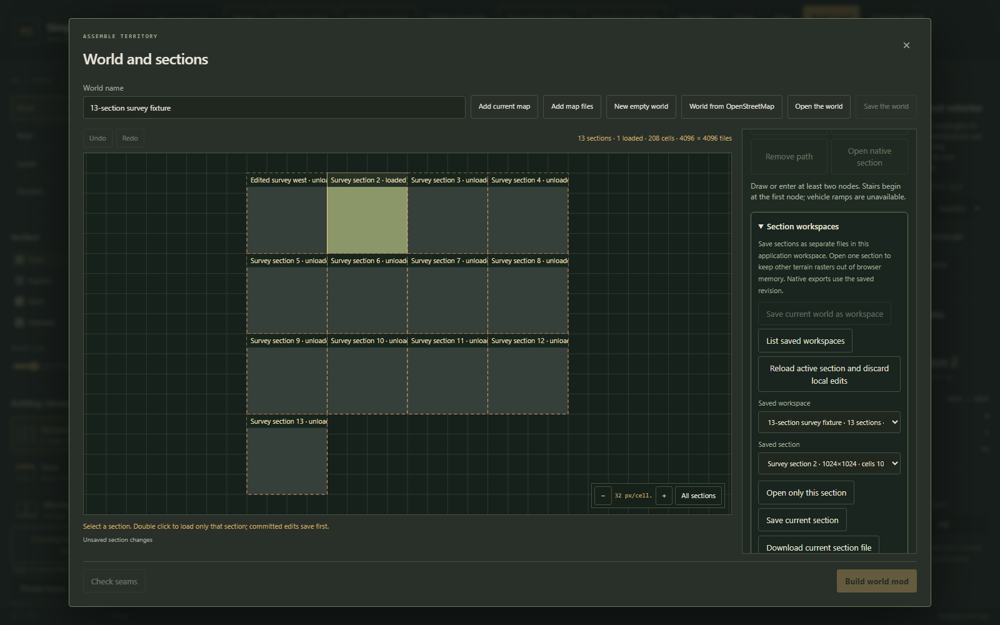
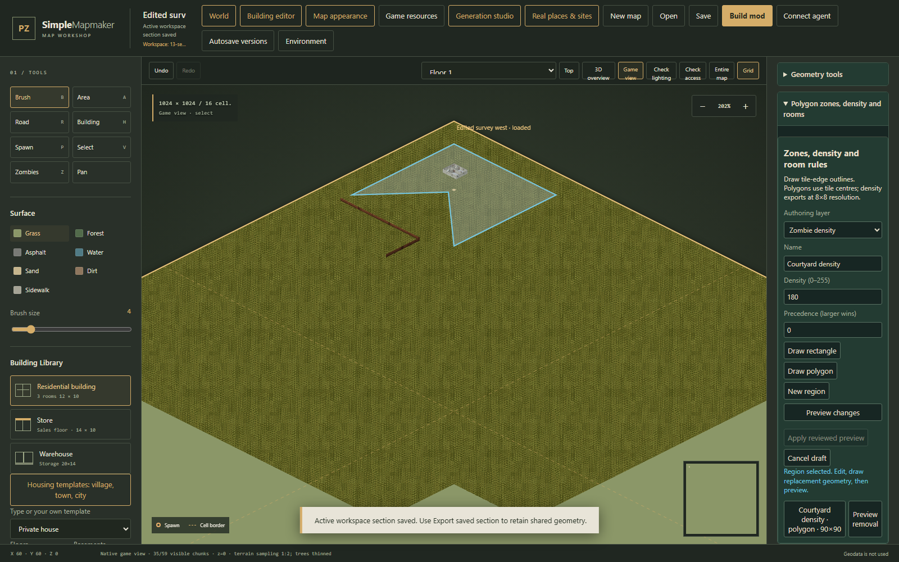

# Streamed world editor

This guide covers the development-branch section workspace, layer controls, geometry drafts and polygon authoring. For installation, start with the [README](../README.md#install-the-ready-to-run-windows-application). Existing `.pzmap.json` and `.pzworld.json` projects remain usable.

## Create a section workspace

1. Start the application with `Start.cmd` and connect the installed game and required mods through **Game resources**.
2. Select **World** in the top toolbar. Use **Add current map** or **Add map files** to assemble adjacent sections. For an existing world, choose **Open the world** and select its `.pzworld.json` file.
3. Check section coordinates and use **Check seams** while the complete world is loaded. Section coordinates are native cells of 256×256 tiles, not individual tiles.
4. Expand **Section workspaces** in the world inspector. Select **Save current world as workspace**. The application writes a manifest, shared metadata and separate immutable section files inside its own workspace.
5. Select **List saved workspaces**, choose the saved workspace, then choose a **Saved section**. Select **Open only this section**.

Only that section's terrain and authoring data enter the editor. Other sections remain entries in the manifest. Dashed outlines and **unloaded** labels describe saved neighbours; they do not represent blank maps. The world overview also supports selecting a section and double clicking to open it.

Saving a complete in-memory world as a workspace is an initial conversion step. Subsequent isolated reads, saves and saved-workspace export jobs do not first rebuild a complete in-memory world. A workspace containing a large number of existing sections should therefore be edited through these controls rather than repeatedly opened through the compatibility complete-world command.

## Edit, switch and save

- Edit the active section normally. Its workspace label shows the active section, saved revision and unsaved state.
- Committed changes are autosaved to the active section. **Save current section** requests an explicit save. Unchanged neighbouring files are reused.
- To switch, select a different saved section and choose **Open only this section**, or double click it in the overview. Current committed changes save before the next raster is loaded.
- Browsing another saved workspace changes the section list without replacing the active edited map. **Save current section** continues to target the active map's original workspace.
- Undo and redo apply to the currently open map. Switching sections starts a new local map history; it does not provide cross-section undo.

An edit made while a neighbouring section downloads prevents the download from replacing the current map. Open the neighbour again after finishing that edit. Cancellation and failed saves leave the current map in place.

### Resolve a revision conflict

Another editor or process can save a newer revision. The application refuses to overwrite it with a stale section. The current local map and unsaved changes remain available.

1. Read the status message in **Section workspaces**. Do not assume a failed save was published.
2. Keep the local map open if its changes are still needed. Saving again against the same stale revision does not merge another author's work.
3. To deliberately replace local changes with the saved copy, choose **Reload active section and discard local edits**. This reloads the latest index and active section. Failed reloads retain the local map.

The discard button is an explicit destructive choice for the current unsaved copy. There is no automatic last-writer-wins merge. **Download current section file** is available when a standalone file can retain its content; sections with crossing shared geometry are rejected by that command because a plain section file would omit their context.

### Restore a retained section revision

**Saved revision** offers the current saved copy and up to three previous retained snapshots. A missing/pruned revision reports an error without changing the active map.

1. Open the section to restore. The controls always target the **active** workspace and section, even while another workspace is selected in the browser list.
2. Select a retained revision and choose **Preview saved revision**. Read the saved name, dimensions, building/object/fence/zone counts and their current counterparts. The preview also calls out current unsaved changes.
3. Choose **Restore preview to active section** only after reviewing that replacement. Restoration changes the section's local terrain and authoring in one undoable editor operation. It retains current shared world geometry and the current workspace index.
4. Save the current section to publish a new revision, or undo to recover the local state that preceded restoration. Normal active-section autosave also applies.

The historical section must have the same origin and dimensions. It is validated against the **current** shared geometry before preview and again before apply. A changed workspace revision, map edit, section switch or changed saved-revision selection invalidates the review. Preview again instead of replacing newer edits. The tool never rolls the entire workspace manifest back to a historical version.

## Shared buildings, paths and exports

Crossing buildings and infrastructure use the shared world geometry. Their projected footprints remain visible in an isolated section and participate in placement checks. Required nearby support samples are read for shared infrastructure; unrelated terrain sections remain unloaded. Missing required samples produce an error rather than invented ground.

Shared geometry is **read-only** in an isolated section. To change a shared building or path, save the active section and choose **Load complete world**. That compatibility operation loads the whole world and retains the complete-world size budget; it is not a streaming shared-object editor.

For native output, choose **Export saved section** or **Export saved world** inside **Section workspaces**. Dirty edits in the active selected workspace save first. The queued job pins a saved revision, checks resources and processes section rasters in sequence. Editing after queueing does not alter that job's input. Progress, cancellation and download use the existing [export queue](EXPORT-JOBS.md).

The native ZIP retains source sections and shared authoring metadata alongside native output. A single-section export includes the necessary clipped shared geometry. Exporting a different browsed workspace uses that workspace's saved revision, not the unrelated map currently being edited.

### Current budgets

- Up to 128 sections and 8,192 native cells per world.
- Each section is 256–2,048 tiles per side, in multiples of 256. A world can extend beyond a single section's dimensions.
- A saved section blob is limited to 48 MiB, shared metadata to 16 MiB and the manifest to 1 MiB. The workspace index does not impose a 128 MiB aggregate raster budget.
- Compatibility complete-world JSON loading/saving retains its explicit 128 MiB budget. Native ZIP/job output is currently bounded to 256 MiB; streaming does not mean unlimited output size. Export selected sections separately when a combined archive exceeds that limit.

These are application storage/authoring budgets. They do not establish a 2,048-tile limit for an entire Project Zomboid world.

### Rotated real-place references

The core geographic reference supports `RotationDegrees` from **−45° to +45°**, with zero preserving existing projection. Positive angles turn source content clockwise in the east/south tile plane. Rotation uses the centre of the geographic bounds and one shared origin for all sections; original WGS84 source coordinates stay unchanged. The [transfer contract](TRANSFER-CONTRACT.md#1-coordinates) provides formulas and the −11.22° Pilna example. This is a saved/import reference capability, not a free-rotation control for an already authored section.

## Use map layers

Expand **Map layers** in the main inspector. The controls cover terrain, roads, paths/fences, buildings, objects, static models, spawns, game zones, zombie density, source boundaries and section seams.

- Clear **Show** to hide a layer without deleting its saved geometry.
- Select **Lock** to prevent edits to that layer. Show and unlock it before editing again. A hidden layer is also protected from editing.
- **Up** and **Down** apply only to source/section annotations and change their overlay order. Ground, walls and other physical sprites retain their geometric depth order.
- Source boundaries use projected source evidence. Showing or hiding them does not rewrite original geographic coordinates.

Layer controls describe the view and editing permissions. They do not remove hidden objects from native exports.

## Finish and apply geometry drafts

Expand **Geometry tools**. Select **Polygon zone**, **Path**, **Fence line** or **Building footprint**.

1. Click vertices on the map; drag handles to adjust them. For a footprint, drag opposite corners.
2. Press **Enter** or choose **Finish draft**. This stores a temporary draft; it does not yet change the map.
3. Select the finished draft. Choose **Edit vertices** to revise it, or **Apply draft** when its adapter supports the geometry.
4. Use **Remove last vertex** or **Backspace** while drawing. **Escape** or **Cancel drawing** cancels the active stroke and retains previously finished drafts.

The current path adapter creates a two-tile sidewalk. Its width and other path properties can then be changed through the existing path editor. A generic polygon applies as a `TownZone`; use the zone panel below when a particular type, density or room mapping is required.

The current building adapter creates a ground-level outbuilding with an exact footprint of **6–64 tiles per side**. Add floors or edit its design afterward. A smaller draft keeps its requested dimensions and cannot be applied through this adapter. Tiny 2×2 sheds and shared-wall behavior await the companion core implementation.

The merged core supports a native fence edge layer with separate fence/gate styles, posts and crossing world lines; see the [fence contract](TRANSFER-CONTRACT.md#4-fences-and-gates). Geometry tools enable **Apply draft** only for supported adapter operations. An unavailable operation keeps its exact draft. Fences are never approximated as ordinary decorations. Existing/imported fence data and dependencies remain part of map/world authoring; a basic drawing adapter does not imply that every gate/style setting has a visual editor.

Expand **Fence resources and gates** before drawing a fence. Choose a saved custom style or a built-in sheet, plank, picket or wire style. Set **Post spacing** from 0 to 64; a style must define a post tile to display posts. Optionally enable **Add a wicket or gate**, choose its registered style, set its first edge offset and opening side. Draw horizontal and vertical runs with explicit corners, finish with Enter and select **Apply draft**. The initial gate is closed. The result reports pieces skipped because of water, buildings or overlaps. A fence and an object may occupy the same cell. Native Game view shows the actual tiles; top view shows the line.

Local drawing keeps the entire line inside its owning section. Edges exactly on the east or south boundary belong to the neighbour; author those as shared world fences rather than silently clipping a local line. Shared fences remain visible and read-only while editing an isolated section.

**Download drafts** saves a separate `geometry-drafts.json`; **Import drafts** restores it. Drafts retain their section and coordinate frame. They cannot be applied to another map origin or size. Pending drafts block explicit map/world saves, exports and section replacement. Downloading them does not clear that protection: apply them or explicitly remove them after retaining the draft file. Normal recovery of already committed map changes continues separately.

## Author polygon zones

Expand **Polygon zones, density and rooms**. The contained panel is titled **Zones, density and room rules**.

1. Choose an **Authoring layer**, a name and its properties.
2. Choose **Draw rectangle** or **Draw polygon**. For a polygon, click the outline, finish with **Enter**, then choose **Apply draft** in **Geometry tools** to transfer the outline into the zone form.
3. Choose **Preview changes**. Review the geometry and returned changes.
4. Choose **Apply reviewed preview**. The accepted candidate becomes one undoable map change.

Polygon vertices lie on integer tile edges. Coverage uses tile centres, including concave outlines. A polygon has one simple outer ring with 3–128 distinct vertices. Holes, self-intersections, backtracking edges and outlines covering no tile centres are rejected. Native game/vehicle zones export as deterministic rectangles covering those tiles; empty concave areas are not filled merely because they lie inside the bounding box.

For vehicle zones, choose a registered distribution and facing direction. Validation checks the actual covered tiles and resource ownership. A valid zone does not guarantee a vehicle spawn; the game distribution and sandbox settings still determine that.

### Zombie density

Select **Zombie density**, set density from **0 to 255**, and set **Precedence**. Larger precedence wins where regions overlap; equal precedence is resolved deterministically by stable ID.

The native density raster has one value per **8×8 tile block**. The preview shows each block's old/new value and how many of its 64 tiles the region covers. A narrow polygon affects only part of a block and its exported value is the rounded mean, not the region's full value everywhere in the bounding box. Results are paged; use **Previous density cells** and **Next density cells** to inspect all of them.

Changing or removing regions restores their baseline contribution while preserving later independent raster edits. A manual write numerically equal to the last region-generated value cannot be distinguished from no change. The stored baseline and ownership metadata travel with the saved section.

### Whole-room mappings

Select **Whole-room mapping**, choose a supported **Existing game room name**, then choose **Any tile intersects** or **All tiles contained**. Draw the region on the selected building level.

The preview lists every affected building, level, room code, previous/new room name and tile count. This changes the **whole room code**, including disconnected pieces sharing that code. Explicitly check **I reviewed all whole-room changes below** before applying. Buildings need explicit floor designs for room review; shared buildings remain read-only in isolated sections.

Room names use the existing game catalog and native aliases. They influence native room/loot behavior; the tool does not create an arbitrary polygon loot distribution. Removing a room rule retains its already reviewed room names. Use map undo to reverse the complete accepted change.

Select an existing region in the list to edit it. **Preview removal** follows the same review/apply flow. Any map edit or section switch invalidates an old preview; preview again before applying.

## Verification scope

Module tests cover revision conflicts, stale/cancelled section loads, explicit reload failure, unloaded-neighbour presentation, geometry capability gates, polygon coverage, density ownership and reviewed room changes. The self-contained browser check uses 13 synthetic 1024×1024 sections, a shared house/fence and a crossing road. It verifies save/switch/reload, polygon density, a drawn fence with a wicket, revision restoration and locked undo. Both the section and combined world archives pass independent native decoding; installed game classes load the section archive. See [verification status](STATUS.md).

Current boundaries: native lighting requires **Load complete world** so that its neighbour halo is present; isolated editing refuses an incomplete lighting calculation. Small building footprints still follow the core's 6×6 minimum. Imported fences crossing sections still need authoritative world-layer promotion in the source importer; their retained source data is not proof of that promotion. Arbitrary shared decoration groups do not yet have a world-level authoring DTO. These limitations are separate from the bounded section readers and native fence export.

The companion developer's private 13 populated Pilna scenes have not been used as an acceptance fixture for this change. Synthetic fixtures establish the tested behavior without claiming that the complete real settlement has already passed validation.

See [zone authoring semantics](ZONE-AUTHORING.md) for field names, source tags, limits and API requests, and the [shared integration contract](SPZM-SCENE-CONTRACT.md) for capabilities still awaiting core implementation.
