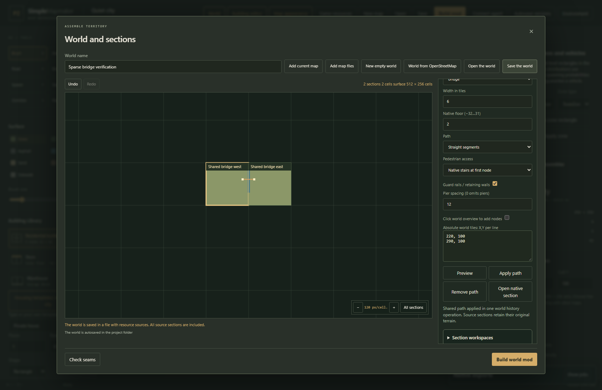
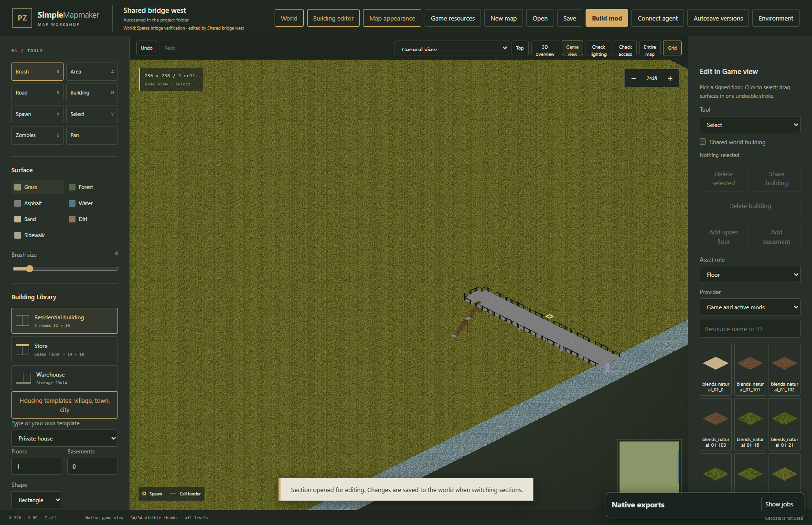

# Shared roads and bridges

World paths are stored once in the world document. They can cross adjacent, independently editable sections. A bridge crossing two 256-tile sections remains one feature, rather than two strokes whose ends must be kept aligned.



## Create a shared path

1. Open **World** and add the sections that the path will cross.
2. Scroll the right inspector to **Shared roads and bridges** and click **New shared path**.
3. Choose a kind and width. Roads, rivers, railways, sidewalks and level-zero causeways use the ground layer. An elevated bridge uses a signed native floor.
4. Enable **Click world overview to add nodes**, then click at least two positions. Alternatively, enter one absolute `X,Y` pair per line under **Absolute world tiles**. Half-tile coordinates are supported.
5. Click **Preview** to validate coverage and native geometry. The preview remains a draft. Click **Apply path** to save it as one world history operation.

Coordinates are measured in game tiles, not native cells. A section at cell `(100,100)` starts at tile `(25600,25600)`. For sections at cells `(0,0)` and `(1,0)`, a path from `220,100` to `290,100` crosses the section boundary between tiles 255 and 256.

Every covered tile must belong to a loaded world section. A path that crosses an empty gap is rejected without changing the world. Moving or removing a section is also rejected if it would leave an existing shared path unsupported by the world layout.

## Floors, stairs and the road below

For a pedestrian bridge, choose **bridge**, a floor above zero, and optionally **Native stairs at first node**. The first node is the upper stair anchor. Native north-facing stair runs descend along the Y axis; reserve four tiles of run per floor between the anchor and the ground landing. A two-floor bridge anchored at `220,100` reaches ground at `220,108`.

- Floors range from **−32 to 31**. The visible floor selector uses the editor's corresponding labels; native z=2 is the third above-ground floor.
- **Guard rails / retaining walls** surrounds exposed deck edges. Rail generation sees the complete world geometry before clipping, so a section boundary does not acquire a fence across the road.
- **Pier spacing** adds supports on a fixed world-coordinate rhythm. Piers avoid ground roads and sidewalks, including shared world paths beneath the bridge.
- An elevated deck preserves the ground terrain beneath it. Water remains water, and a road can pass under the deck at its original floor.
- Stairs require a dry, clear ground landing. Buildings, occupied geometry and authored stair openings are checked before a change is accepted.
- Native stairs provide pedestrian access. Vehicle ramps between floors are unavailable.

Negative floors create underground decks. The same stair controls provide access from ground level, and the guard option creates retaining walls along the sides. Native stair shafts deliberately remove the blocking floor squares above their runs.



Select a saved path and click **Open native section** to inspect its first section in Game view. **General view** shows the terrain, supports and stairs together; a single floor isolates the deck. This view clips to the selected section. The adjacent section and the combined native export retain the continuation.

## Ground paths and railways

Shared ground paths are projected over a temporary copy of each section. Manual terrain edits, explicit surfaces, buildings, props, models and spawns remain protected. Road, sidewalk and railway strokes do not replace water; use an elevated bridge or a level-zero causeway where appropriate. Rivers preserve existing road and pavement crossings.

Railways use native paired track artwork on ballast. Railway paths require straight cardinal segments; add an orthogonal node to turn. The artwork does not provide train simulation. Shared infrastructure and track sprites require their original game resource provider; a mod that replaces those tile definitions must be disabled before authoring or exporting them.

## Save, history and separate sections

- **Undo** and **Redo** in the world window apply to the complete shared path operation. **Remove path** removes the shared source; the section's original terrain remains available.
- **Save the world** writes the authoritative paths into `.pzworld.json`, using world format 6. Browser recovery and separate section workspaces preserve the same shared layer.
- A section opened alone retains its editable local source. Its workspace metadata keeps the shared paths. Load the complete world to edit or inspect those paths in context.
- Saving a changed section checks it against the saved shared infrastructure. A new building intersecting the bridge, or water placed on its stair landing, is rejected before the workspace revision changes.
- Browser publication to an agent session and OSM reimport with **Preserve edits** retain shared paths. OSM preservation requires the original geographic bounds, scale and section layout.

**Build world mod** exports all sections as one native map. The archive contains the original `world.pzworld.json`. A selected section export includes its clipped native geometry and shared-world context while preserving the independent local `.pzmap.json` source. Projected deck geometry and terrain are not copied into the section's authoring layer.

## Verified behavior

The automated browser scenario authors a bridge across two separate sections at tiles 255/256, checks preview, apply, removal, undo and redo, and reads both native viewport sides. Independent LOT readers verify a deck at z=2 above water at z=0, with no rail across the section seam. The checks also inspect installed game floor, stair and rail properties and round-trip the shared source through a section workspace.

Run from the repository in PowerShell:

```powershell
. ./scripts/WorkspaceEnv.ps1
$env:PZMAP_TEST_URL='http://127.0.0.1:48777'
node scripts/verify-world-infrastructure.mjs
```

Point the URL at a running editor. The test writes disposable fixtures, native exports and screenshots below `work/qa-results/world-infrastructure`. It does not launch a game session.
